# HỒ SƠ DỰ ÁN DỰ THI BẢNG C
Cuộc thi Sáng tạo trẻ Quốc gia trong lĩnh vực Trí tuệ nhân tạo năm 2026 (Đội `DUT.StarTracker` · Mã dự thi `AI26C0083`)

## Thông tin đội thi
- Số lượng thí sinh: 3 người (theo hồ sơ gốc)
- Thí sinh 1 (đội trưởng): Hoàng Trần Đức Hải — 08/11/2006 — 0852881106 — hoangtranduchai@gmail.com
  - Lớp 24T_Nhat1, Khoa Công nghệ thông tin, Trường Đại học Bách khoa, Đại học Đà Nẵng
  - Địa chỉ: Đường Khái Tây 6, Phường Ngũ Hành Sơn, thành phố Đà Nẵng
- Thí sinh 2: Nguyễn Tiến — 28/10/2006 — 0857674338 — nguyentien281006@gmail.com
  - Lớp 24T_Nhat1, Khoa Công nghệ thông tin, Trường Đại học Bách khoa, Đại học Đà Nẵng
  - Địa chỉ: 22/143 Phan Bội Châu, Phường Thuận Hóa, Thành Phố Huế
- Thí sinh 3: Mai Tạ Trúc Vy — 20/01/2006 — 0905702982 — maitatrucvy@gmail.com
  - Lớp 24T_DT1, Khoa Công nghệ thông tin, Trường Đại học Bách khoa, Đại học Đà Nẵng
  - Địa chỉ: 67 Nguyễn Sắc Kim, Phường Hòa Xuân, Thành phố Đà Nẵng
- Trường: Trường Đại học Bách khoa, Đại học Đà Nẵng
- Khoa: Khoa Công nghệ thông tin
- Mã nguồn: https://github.com/hoangtranduchai/star-tracker (nhánh `feat/national-round-stage1`)

## NỘI DUNG HỒ SƠ DỰ ÁN

### 1. Bài toán hoặc vấn đề thực tiễn cần giải quyết

Bài toán thực tiễn: từ ảnh bầu trời sao xác định hướng (attitude) của trục máy ảnh trong hệ J2000 khi không có tư thế ban đầu (lost-in-space). Ba bước: ước lượng tâm sao dưới mức một pixel; nhận dạng sao bằng hình học góc và catalog; giải Wahba ra quaternion. Đầu ra gọn (4×float32 = 16 byte; hoặc 16 byte 0x00 khi LOST), chạy hoàn toàn trên phần mềm demo laptop cho sinh viên CNTT (chưa kiểm chứng trên phần cứng vệ tinh/ADCS bay). Attitude là góc/hướng, không dùng GSD mét mặt đất. Điểm sáng tạo: (1) hệ lai CoG|CNN trên cùng pipeline Pyramid→Wahba kèm chốt chặn từ chối khớp sai (0% vs 41% legacy False Lock); (2) so sánh công khai MobileUNet (Zhao et al.) không huấn luyện lại và đối soát E2E trên 540 khung mô phỏng + ảnh thật hiệu chuẩn; (3) ca khó ảnh núi thật LOST — CoG tách 111 điểm (25 núi/cây) nên bị chặn LOST an toàn, trong khi CNN tách 79 điểm (chỉ 1 núi/cây) và giải đúng.

### 2. Mục tiêu, phạm vi và đối tượng ứng dụng của sản phẩm

Mục tiêu: (1) phát hiện và ước lượng tâm sao; (2) Pyramid/Mortari + K-vector trên Yale BSC5 (V ≤ 6, 5.023 sao) kèm chốt chặn từ chối khớp không hợp lệ (`LOST` + `reject_code`); (3) quaternion J2000 16 byte (Wahba SVD/QUEST) và kiểm chứng End-to-End 3-DOF trên ảnh thật hiệu chuẩn lẫn mô phỏng. Phạm vi: phần mềm demo nghiên cứu chạy trên máy tính cá nhân (Laptop RTX 5070 / CPU) — KHÔNG phải sản phẩm bay, chưa thử bức xạ hay phần cứng ADCS vệ tinh. Camera demo: máy ảnh tĩnh APS-C 24 MP (6000×4000, pixel 3,72 µm, f=50 mm, FOV ≈ 25,16°×16,93°). Bộ đo benchmark: 1024×683 (pixel 21.796875 µm, f=50.0 mm) cùng lớp FOV demo. Đơn vị: Trường Đại học Bách khoa, Đại học Đà Nẵng — Khoa Công nghệ thông tin.

### 3. Dữ liệu sử dụng, nguồn dữ liệu và tính hợp lệ của dữ liệu

Dữ liệu: (a) catalog Yale BSC5 công khai (5.023 sao V≤6 sau lọc cặp gần <60″) và Hipparcos I/239 (dự phòng/đối chiếu Alt40 V≤7); (b) 500 khung mô phỏng sẵn data/sim_dataset/hd1024 và 40 khung lóa data/sim_dataset/hd1024_glare (1024×683, không sinh lại ảnh); (c) trọng số MobileUNet_B10_50.pt công khai, không huấn luyện lại; (d) bộ ảnh thật hiệu chuẩn (data/real_calibrated/manifest_real_calibrated.json): ESA tetra3 FLIR Blackfly S (Alt40, Alt60), Zhao MT9V022 (nightsky_june16_2021.npy, verification_img.npy), UW LOST Mount St. Helens (mount_st_helens_1.png, 4,2 mm / 4,1 µm), NTNU góc rộng 77,5° chưa hiệu chuẩn (0006.png); (e) hình minh họa bài báo Zhao (chỉ trích dẫn). Không thu thập dữ liệu cá nhân.

### 4. Quy trình tiền xử lý, làm sạch, chuẩn hóa hoặc tổ chức dữ liệu

Tiền xử lý CoG: nền cục bộ (bg_block=32→33 ở chế độ fast trong pipeline, 64 ở full), ngưỡng MAD, opening 3×3, connected components, trọng tâm cường độ. Nhánh CNN: chuẩn hóa mean/std tác giả, chia thang bit (8-bit, 12-bit /16, 16-bit thực /256), pad chia hết 32, segmentation + distance map d_th=2 (public run_neural_net); trên ảnh 8-bit/16-bit thực xếp hạng hạt giống theo độ tương phản cục bộ (outdoor_seed_scores). Catalog: K-vector theo FOV đường chéo.

### 5. Thuật toán, mô hình, phương pháp hoặc công cụ trí tuệ nhân tạo được sử dụng

Mặc định không học máy: CoG → Pyramid/Mortari + K-vector → Wahba SVD/QUEST + hậu kiểm ngoại lai & suy biến thẳng hàng SVD (`s_min >= 1e-6`). Tùy chọn AI: MobileUNet công khai chỉ thay bước centroid (Zhao et al.). Công cụ: Python, NumPy, SciPy, OpenCV, PyTorch CUDA, pytest, app.py, demo_star_tracker.py. Trích dẫn Zhao et al., arXiv:2404.19108 (không phải số đo của nhóm): MobileUNet ≈ 0,020 s/khung trên RTX 2060M (Table V; ~20 ms @ 640×480); MobileUNet trên Google Coral Edge TPU ≈ 266 ms (Table VI; số tác giả ≈ 265,5 ms); RMSE centroid tổng hợp MobileUNet ≈ 0,1695 px vs CoG ≈ 0,6966 px trên ảnh tổng hợp sạch (Table III). Hình minh họa nguồn tác giả: data/outputs/zhao_paper_figures/ — chú thích «Nguồn: Zhao et al., arXiv:2404.19108».

### 6. Quy trình huấn luyện, tinh chỉnh, tích hợp hoặc khai thác mô hình (nếu có)

Không huấn luyện lại CNN. Suy luận trên NVIDIA GeForce RTX 5070 Laptop GPU, cnn_torch_device=cuda, torch 2.11.0+cu128. Ngưỡng distance-map công khai = 2. Đã bổ sung hỗ trợ ảnh 16-bit từ camera thật (`img/256.0` + xếp hạng contrast SNR) trong `src/centroid_cnn.py` và mô hình tâm quang học `(cx, cy)` hiệu chuẩn trong `src/camera.py`. Lần đo cũ sai ngưỡng ~0,707 đã bị loại bỏ hoàn toàn.

### 7. Chỉ số, phương pháp hoặc tiêu chí đánh giá kết quả

Chỉ số đánh giá End-to-End (đã triển khai đầy đủ trong `src/metrics.py` và `scripts/benchmark_end_to_end.py`): (1) Solve Rate, True Solve Rate (3-DOF Δθ < giới hạn, ví dụ 40″ trên hd1024), False Lock Rate (giải được nhưng Δθ > 300″), LOST Rate và phân rã `reject_code`; (2) Sai số quaternion 3-DOF Δθ (arcsec) kèm phân rã Cross-Boresight (`hypot(dx, dy)`) và Roll (`|dz|`); (3) Centroid Precision, Recall, F1, False Positives và RMSE (≤3 px & ≤5 px); (4) Độ trễ toàn pipeline (`mask_ms`, `centroiding_ms`, `identification_ms`, `attitude_ms`, `total_pipeline_ms`).

### 8. Kết quả thử nghiệm, phân tích ưu điểm, hạn chế và khả năng mở rộng

KẾT QUẢ KIỂM TOÁN & END-TO-END (VÒNG CHUNG KẾT · CHẶNG 1, trên NVIDIA GeForce RTX 5070 Laptop GPU):
1) Chốt chặn từ chối khớp sai (`benchmark_rejection_stress.json`, 100 ca đối kháng): Sau cải tiến False Lock = 0/100 (0,0%, 100/100 downlink 16 byte 0x00) so với Legacy trước sửa = 41/100 (41,0% False Lock: 16/25 ca ngoại lai <3 inlier và 25/25 ca 3 sao thẳng hàng).
2) Benchmark Centroid 500 khung hd1024 (`centroid_benchmark_hd1024_thr2.json`, d_th=2, 27.017 sao GT): CoG RMSE tb 0,1804 px · 34,23 ms tv · 25.206/27.017 (Recall 93,3% · Precision 100,0% · 0 FP); CNN RMSE tb 0,4745 px · 60,17 ms tv · 25.050/27.017 (Recall 92,7% · Precision 75,4% [25.050/33.241 · 8.191 sao giả]). Lóa mạnh 40 khung: CoG RMSE 0,1449 px vs CNN 0,3951 px.
3) Đánh giá End-to-End 500 khung hd1024 & 40 khung lóa (`benchmark_sim_hd1024_e2e.json`, `benchmark_sim_glare_e2e.json`): 500 khung sạch — CoG giải đúng 500/500 (<40″: 100,0%, 0% False Lock, Δθ trung vị 2,00″, P90 6,26″, tổng pipeline 87,2 ms); CNN giải 500/500, đạt <40″ 498/500 (99,6%, 0% False Lock, Δθ trung vị 7,94″, P90 20,40″, 123,9 ms, Precision 95,5%, Recall 87,0%, 1.118 FP). 40 khung lóa — CoG 40/40 (<40″, tv 1,99″, 78,3 ms); CNN 39/40 (<40″, tv 10,59″, 131,1 ms), 0% False Lock. Khung đơn Seed 42 FAST (`seed42_cog_vs_cnn.json`): CoG 0,446″ (36/36, Prec/Rec 100%) vs CNN 1,648″ (30/36, Prec 85,7%, Rec 83,3%).
4) Đánh giá End-to-End trên ảnh trời thật (`benchmark_real_calibrated_e2e.json`, 0% False Lock): Quang học danh nghĩa (6 khung BSC5) CoG 0/6, CNN 1/6 (MSH). Quang học hiệu chuẩn (5 khung BSC5) CoG 1/5 (Alt60 2,26″), CNN 3/5 (Alt60 4,65″, Zhao MT9V022 54,70″, MSH 120,26″). Ca bổ sung Hipparcos V≤7 giải Alt40 đạt CoG 39,51″ / CNN 26,60″. NTNU 0006.png (FOV 77,5° chưa hiệu chuẩn méo) và Zhao verification_img.npy (4 đốm) đều trả về LOST an toàn. Attitude sau cải tiến vs UW LOST (RA 310.446° · Dec +36.0229°): CNN SOLVED: RA 310.48° Dec +36.00° (Δ 0.034° vs UW LOST; 3-DOF vs manifest 110.05″) · khớp 54/79 · ~2.76 s; CoG hậu kiểm (sau siết chốt chặn ngoại lai): LOST [INSUFFICIENT_INLIER_PAIRS] (tách 106 điểm với GlareMasker + bg_block=32→33, chỉ còn 1 inlier < 3 nên từ chối an toàn, 0% khóa sai; trước sửa giải 64/106 ~16.2 s lệch 0.094°). Đối soát 111 vs 106 điểm: CentroidDetector độc lập (bg_block=31, không mask) tách 111 điểm (40.3 ms), còn StarTrackerPipeline (GlareMasker + bg_block=33) tách 106 điểm. Trích dẫn Zhao et al., arXiv:2404.19108 (không phải số đo của nhóm): MobileUNet ≈ 0,020 s/khung trên RTX 2060M (Table V; ~20 ms @ 640×480); MobileUNet trên Google Coral Edge TPU ≈ 266 ms (Table VI; số tác giả ≈ 265,5 ms); RMSE centroid tổng hợp MobileUNet ≈ 0,1695 px vs CoG ≈ 0,6966 px trên ảnh tổng hợp sạch (Table III). Hình minh họa nguồn tác giả: data/outputs/zhao_paper_figures/ — chú thích «Nguồn: Zhao et al., arXiv:2404.19108». Không claim phần cứng bay/ADCS.

### 9. So sánh với phương án hoặc mô hình cơ sở, phân tích đóng góp của các thành phần trong hệ thống (nếu có)

Baseline CoG + Pyramid + K-vector + Wahba. Trên 500 khung hd1024 (d_th=2): CoG thắng cả về RMSE (0,1804 vs 0,4745 px), Precision (100,0% vs 75,4%), độ trễ E2E (87,2 vs 123,9 ms) và Δθ (2,00″ vs 7,94″). Đóng góp cải tiến Chặng 1: (1) chốt chặn 0% False Lock trước & sau `_associate_remaining` + SVD rank check; (2) mở rộng CNN cho ảnh 16-bit camera thật + giải 3-DOF trên tập ảnh hiệu chuẩn ESA tetra3 & Zhao; (3) đối soát triệt để log–tài liệu–slide.

### 10. Kiến trúc hệ thống và phương án triển khai

Kiến trúc: camera model (có tâm cx, cy & Brown-Conrady) → GlareMasker → centroid (CoG | CNN 8/12/16-bit) → Pyramid/K-vector → _refine_inliers (tiền/hậu _associate_remaining + SVD rank) → FOV consistency → quaternion 16 byte (0x00 khi LOST). Chạy kiểm thử & benchmark: `pytest -v`; `python scripts/benchmark_end_to_end.py --suites all`; `python scripts/reconcile_logs.py`; `python demo_star_tracker.py --mode fast --seed 42 --lookup`; `python app.py` (giao diện Web tối giản kèm API `GET /api/sky-catalog` dựng không gian 3D quỹ đạo Trái Đất & thiên cầu thực J2000 5.023 sao Yale BSC5 để đối chiếu trực quan tư thế vệ tinh 3D với khung ảnh gốc, có kịch bản nhanh `Mẫu chuẩn Seed 42`, `Bầu trời thật ESA`, `Núi St. Helens`, `Ngược nắng lóa mạnh` — mô phỏng trực quan trên PC, chưa kiểm chứng phần cứng bay/ADCS).

### 11. Phân tích rủi ro, yêu cầu bảo mật, đạo đức trí tuệ nhân tạo và an toàn dữ liệu

Rủi ro & kiểm soát: (1) Khớp sai hoặc hình học thẳng hàng → đã chặn bằng `_refine_inliers`, SVD `s_min >= 1e-6` và `LOW_FOV_CONSISTENCY` (0% False Lock trên 100 ca đối kháng & 540 khung sim); (2) Ảnh thiếu sao sáng BSC5 (Alt40) hoặc méo ống kính rộng chưa hiệu chuẩn (NTNU 0006.png) → hệ thống trả LOST an toàn; (3) CNN lệch miền 12-bit trên ảnh mô phỏng → mặc định Auto-Router chạy CoG trước, xác thực SHA-256 trước `torch.load` và báo tường minh khi xảy ra Fallback CNN → CoG trong nhật ký nguyên tử `data/outputs/execution_log.jsonl` + dải cảnh báo Web UI; (4) Kiểm soát dữ liệu ảnh tải lên (`src/upload_store.py`): giao diện không có tài khoản người dùng; ảnh tải lên, nhãn JSON sidecar và 4 ảnh xem trước được cách ly vào thư mục UUID4 riêng `data/user_uploads/<upload_id>/` gắn cookie phiên `st_sid` (`HttpOnly`, `SameSite=Lax`, 0% ghi đè tệp trùng tên hay ảnh mẫu `data/uploads/`, rollback xóa sạch khi lỗi HTTP 400/409), chế độ mặc định `ephemeral` xóa vĩnh viễn 0 giây trong khối `finally:` (preview trả inline base64), chế độ tùy chọn `ttl` lưu tối đa 15 phút (900s, luồng nền tự dọn mỗi 60s) và hỗ trợ xóa tức thì qua `DELETE /api/uploads[/<id>]` (ghi dấu `DATA_DELETION`); (5) Phạm vi: toàn bộ số liệu đo trên PC Laptop (RTX 5070 / CPU / ARM64 TRL 3–4) — KHÔNG chứng minh khả năng chịu bức xạ hay sẵn sàng phần cứng vệ tinh/ADCS.

### 12. Hướng phát triển, hoàn thiện và khả năng ứng dụng trong thực tiễn

Phân định rõ phạm vi: hiện tại đã hoàn thành kiểm thử chốt chặn False Lock, đánh giá E2E trên 540 khung mô phỏng và 6 khung ảnh thật hiệu chuẩn/stress trên PC. Kỳ vọng phát triển tương lai (chưa kiểm chứng bay): (1) tinh chỉnh có kiểm soát MobileUNet cho miền 12-bit; (2) mở rộng tập ảnh bầu trời thật đa quang học; (3) tối ưu C++/nhúng và thử nghiệm phần cứng/HIL hướng tới ứng dụng học thuật hoặc payload vệ tinh cỡ nhỏ sau này.

### 13. Lịch sử câu lệnh và hình ảnh minh chứng quá trình phát triển sản phẩm từ bản nháp đến khi hoàn thiện

Minh chứng đã khóa: `data/outputs/log_reconciliation_audit.json`, `data/outputs/benchmark_real_calibrated_e2e.json`, `data/outputs/benchmark_sim_hd1024_e2e.json`, `data/outputs/benchmark_sim_glare_e2e.json`, `data/outputs/benchmark_rejection_stress.json`, `data/outputs/seed42_cog_vs_cnn.json`, `data/outputs/centroid_benchmark_hd1024_thr2.json`, `data/outputs/mount_st_helens_{centroid,lost}_compare.json`, `data/outputs/e2e_figures/*.png`, `data/outputs/failure_cases/*.png`, `AI2026_Portfolio/BAO_CAO_CAI_TIEN_VONG_CHUNG_KET_CHANG_1.{md,docx,pdf}`, `AI2026_Portfolio/AI2026_SLIDE_THUYET_TRINH.pptx`. Mã nguồn GitHub: https://github.com/hoangtranduchai/star-tracker (nhánh `feat/national-round-stage1`). Video minh chứng: cập nhật khi quay bản hoàn thiện.

## Hình minh chứng

### Demo nhóm — ảnh núi thật LOST (CoG cam vs CNN xanh)

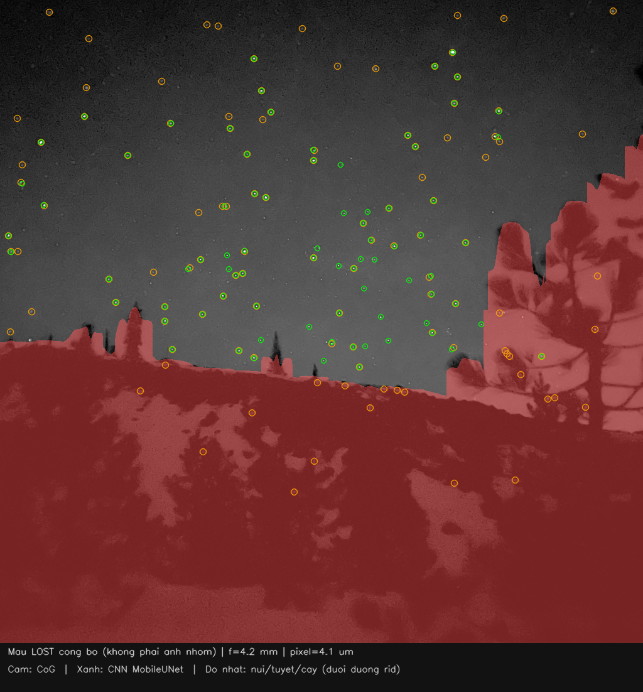

*Chú thích: ảnh thật công bố kèm LOST, không phải ảnh của nhóm chụp; thông số 4,2 mm và 4,1 µm. Cam = CoG; xanh = CNN MobileUNet (d_th=2). Đỏ nhạt = mặt nạ núi/cây heuristic.*

- Đo centroid độc lập (`bg_block=31`, không mask): CoG tổng 111 (núi/cây 25, trời 86); CNN tổng 79 (núi/cây 1, trời 78).
- Attitude sau cải tiến vs UW LOST (RA 310.446° · Dec +36.0229°): CNN SOLVED: RA 310.48° Dec +36.00° (Δ 0.034° vs UW LOST; 3-DOF vs manifest 110.05″) · khớp 54/79 · ~2.76 s; CoG hậu kiểm (sau siết chốt chặn ngoại lai): LOST [INSUFFICIENT_INLIER_PAIRS] (tách 106 điểm với GlareMasker + bg_block=32→33, chỉ còn 1 inlier < 3 nên từ chối an toàn, 0% khóa sai; trước sửa giải 64/106 ~16.2 s lệch 0.094°). Đối soát 111 vs 106 điểm: CentroidDetector độc lập (bg_block=31, không mask) tách 111 điểm (40.3 ms), còn StarTrackerPipeline (GlareMasker + bg_block=33) tách 106 điểm.

### Demo nhóm — khung sim hd1024 (1024×683)

*Chú thích: demo của nhóm, 1024×683 — không phải số liệu bài báo.*

### Minh chứng cải tiến Vòng Chung kết · Chặng 1

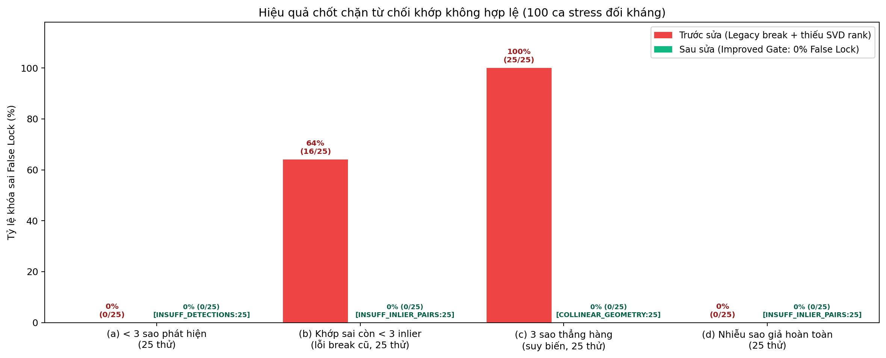

*Chốt chặn từ chối khớp sao không hợp lệ trên 100 ca stress đối kháng (0% vs 41% False Lock)*

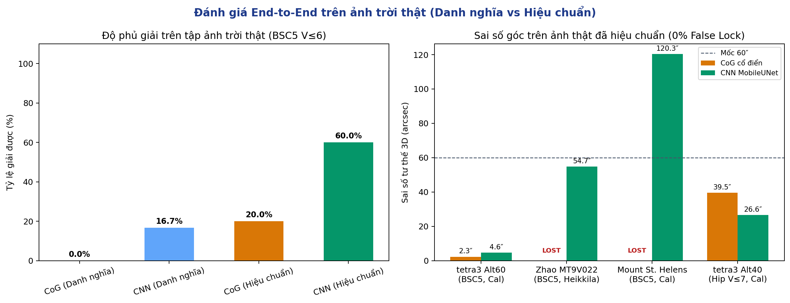

*Đánh giá End-to-End trên tập ảnh trời thật (Danh nghĩa vs Hiệu chuẩn, 0% False Lock)*

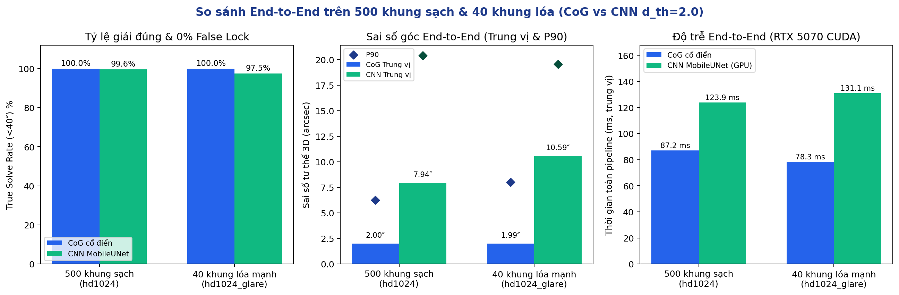

*Đánh giá End-to-End 500 khung hd1024 sạch và 40 khung lóa mạnh (CoG vs CNN d_th=2.0)*

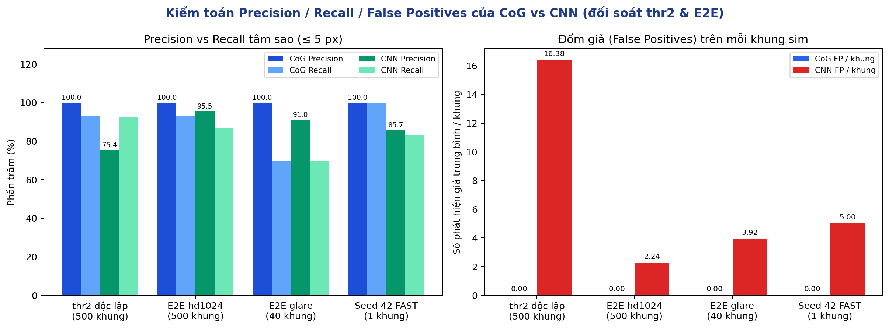

*Đối soát Precision / Recall / Đốm giả (FP) của CoG và CNN trên thr2 & E2E*

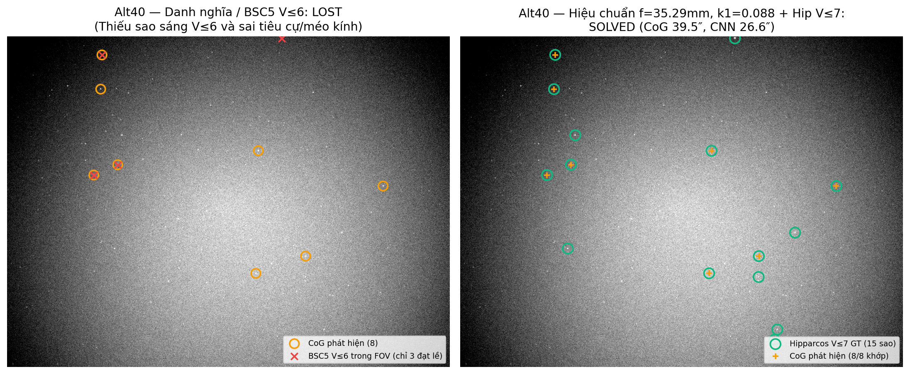

*Ca lỗi ảnh thật: ESA tetra3 Alt40 (BSC5 V≤6 danh nghĩa LOST vs hiệu chuẩn + Hipparcos V≤7 SOLVED)*

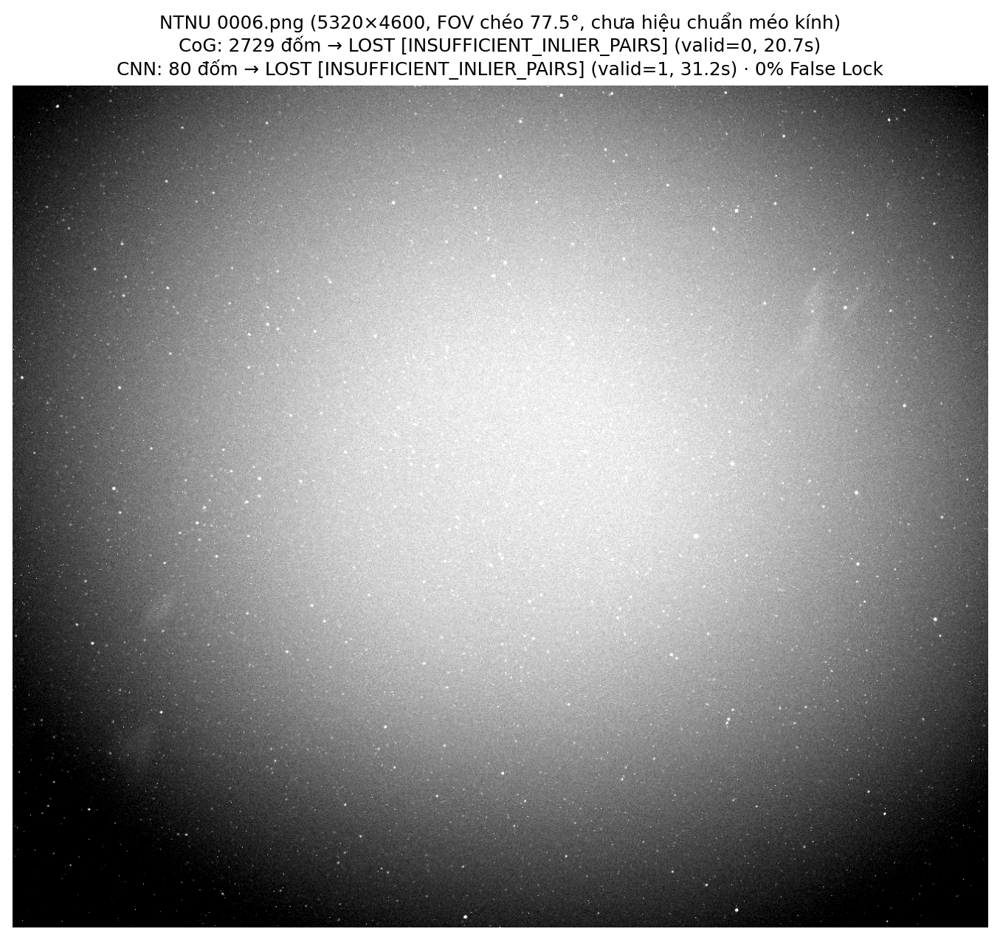

*Ca lỗi ảnh thật: NTNU 0006.png góc siêu rộng 77,5° chưa hiệu chuẩn méo — trả về LOST an toàn (0% False Lock)*

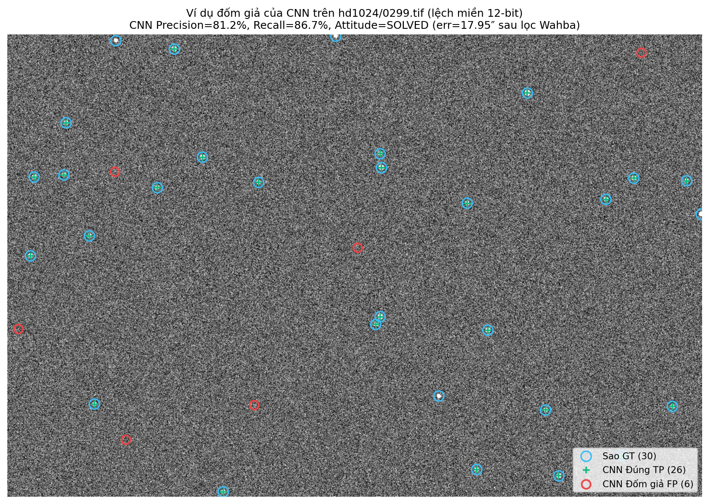

*Ca phân tích đốm giả CNN trên hd1024/0299.tif (6 FP do lệch miền 12-bit, Wahba vẫn giải đúng sau lọc ngoại lai)*

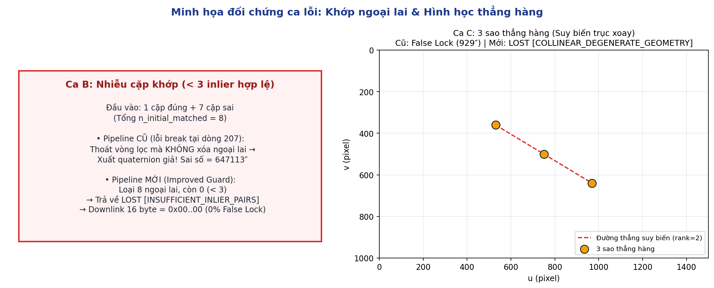

*Đối chứng ca lỗi: Khớp ngoại lai (<3 inlier) và 3 sao thẳng hàng bị từ chối LOST sau cải tiến*

### Nguồn Zhao et al., arXiv:2404.19108 (không phải đo của nhóm)

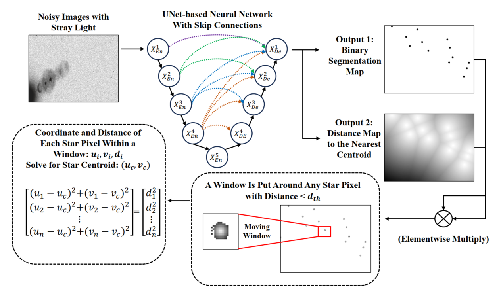

*Flowchart phương pháp — Nguồn: Zhao et al., arXiv:2404.19108*

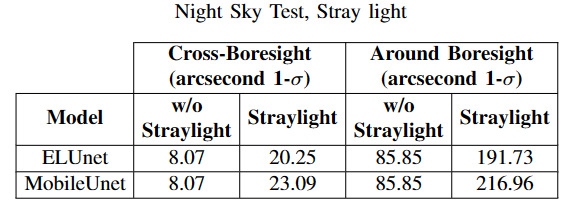

*Night sky + stray light — Nguồn: Zhao et al., arXiv:2404.19108*

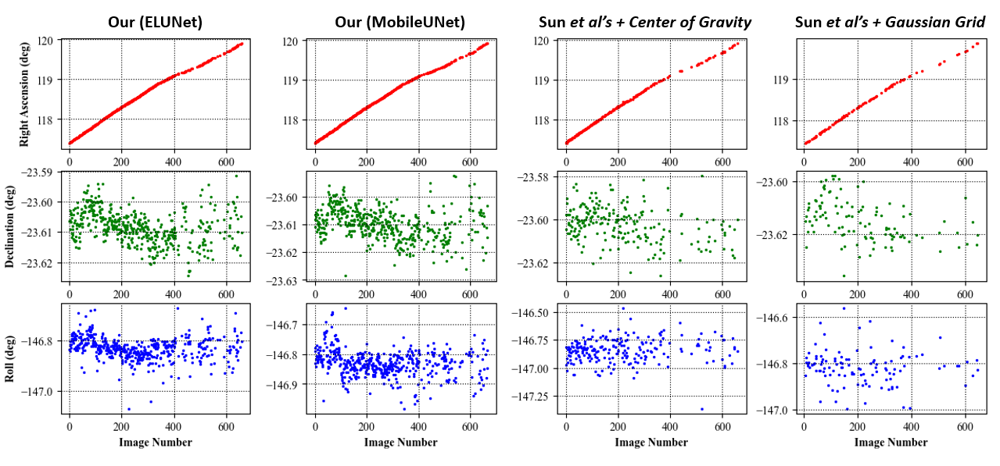

*Attitude so sánh — Nguồn: Zhao et al., arXiv:2404.19108*
