# BÁO CÁO CẢI TIẾN VÒNG CHUNG KẾT · CHẶNG 1
**Cuộc thi Sáng tạo trẻ Quốc gia trong lĩnh vực Trí tuệ nhân tạo năm 2026 (Bảng C)**  
**Đề tài:** Star Tracker — Hệ thống định hướng bầu trời sao lai CoG | CNN (Demo nghiên cứu trên PC)  
**Đề cải tiến áp dụng:** Phiên bản 1 · Vòng Chung kết · Chặng 1

---

## 1. Thông tin đội thi & Đối chiếu phản biện 3 yêu cầu cải tiến

| Hạng mục | Thông tin xác thực |
| --- | --- |
| Mã dự thi & Đội thi | AI26C0083 — Đội DUT.StarTracker (Bảng C — Sinh viên Đại học) |
| Thành viên thực hiện | Hoàng Trần Đức Hải (Đội trưởng) · Nguyễn Tiến · Mai Tạ Trúc Vy |
| Đơn vị đào tạo | Khoa Công nghệ thông tin — Trường Đại học Bách khoa, Đại học Đà Nẵng |
| Nhánh mã nguồn cải tiến | https://github.com/hoangtranduchai/star-tracker (nhánh feat/national-round-stage1) |
| Môi trường đo kiểm chuẩn | PC Laptop · NVIDIA GeForce RTX 5070 Laptop GPU · PyTorch CUDA · pytest (127 passed, 2 skipped) |

### 1.1. Tóm tắt bằng chứng sai sót trước cải tiến & Ma trận khắc phục 3 yêu cầu

Qua quá trình rà soát mã nguồn gốc (`HEAD`), dữ liệu đo kiểm và bộ hồ sơ/slide trước đây, nhóm `DUT.StarTracker` xác nhận các lỗ hổng kỹ thuật và sai lệch tài liệu cụ thể đã tồn tại. Toàn bộ Chặng 1 tập trung khắc phục triệt để 3 yêu cầu sau:

| Yêu cầu Chặng 1 | Bằng chứng lỗ hổng / sai lệch trước cải tiến | Giải pháp kỹ thuật đã triển khai | Kết quả xác minh sau cải tiến |
| --- | --- | --- | --- |
| Yêu cầu 1<br>Ngăn trả tư thế từ khớp không hợp lệ | • HEAD:src/pipeline.py (dòng 98–100) có lỗi break khi <3 inlier làm giữ nguyên cặp ngoại lai.<br>• Giải lại sau _associate_remaining không lọc dư.<br>• HEAD:src/attitude.py không kiểm tra suy biến thẳng hàng.<br>• Thiếu status LOST, reject_code, match_stats. | • Sửa src/pipeline.py: _dedup_pairs 1-1; _refine_inliers lặp cả TRƯỚC và SAU _associate_remaining; kiểm RMS hậu kiểm, min_stars ≥ 4 và FOV consistency.<br>• Sửa src/attitude.py: kiểm SVD s_obs[-1] ≥ 1e-6 và s_ref[-1] ≥ 1e-6.<br>• Trả status="LOST", q=None, 16 byte 0x00, reject_code rõ ràng.<br>• Bổ sung tests/test_invalid_match_rejection.py & benchmark 100 ca đối kháng. | 0/100 False Lock (0,0%) vs 41/100 (41,0%) ở mã cũ; 100/100 downlink 0x00. |
| Yêu cầu 2<br>Đánh giá End-to-End (ảnh thật hiệu chuẩn & sim lớn) | • Hồ sơ cũ mới chấm centroid trên 500 khung hd1024; attitude Δθ mới kiểm 1 khung Seed 42.<br>• CNN chưa xử lý chuẩn ảnh 16-bit thật; CameraModel chưa hỗ trợ tâm (cx, cy) hiệu chuẩn.<br>• src/metrics.py chưa phân loại FALSE_LOCK/LOST/Precision/Recall. | • Mở rộng src/camera.py (cx, cy) và src/centroid_cnn.py (chia thang 8/12/16-bit + contrast SNR).<br>• Mở rộng src/metrics.py (Precision/Recall/F1, Cross-Boresight/Roll, SOLVED_CORRECT/WARN/FALSE_LOCK/LOST).<br>• Tạo manifest_real_calibrated.json (ESA tetra3, Zhao MT9V022, UW LOST MSH, NTNU 0006.png) & benchmark_end_to_end.py (500 hd1024 + 40 lóa + 6 ảnh thật + Seed 42). | E2E 500 khung hd1024 (CoG 100,0%, CNN 99,6% <40″), 40 lóa, 6 ảnh thật hiệu chuẩn; 0% False Lock. |
| Yêu cầu 3<br>Đối soát Log–Tài liệu–Slide & Phạm vi PC Demo | • Slide 7 ghi sai 25206/27017 (100%) & 25050/27017 (98,4%).<br>• Slide 12 chứa số ma 12.592/12.592.<br>• Chưa giải thích 111 vs 106 trên MSH; Seed 42 ~1,65″ chưa log.<br>• Còn câu overclaim "sẵn sàng tích hợp vệ tinh", "ADCS", "sát quỹ đạo". | • Viết scripts/reconcile_logs.py xuất log_reconciliation_audit.json (21 sai lệch).<br>• Sửa toàn bộ PPTX (nâng lên 17 slide), MD, DOCX, Kịch bản, BGK, README.<br>• Phân định rạch ròi kết quả đo trên PC Laptop vs kỳ vọng phần cứng bay chưa kiểm chứng. | 0 sai lệch còn sót; 100% số liệu trích từ JSON đã kiểm toán. |

---

## 2. Yêu cầu 1 — Ngăn trả kết quả tư thế từ khớp sao không hợp lệ

### 2.1. Phân tích nguyên nhân gốc tại mã nguồn cũ

Kiểm tra lại mã nguồn gốc `HEAD:src/pipeline.py` và `HEAD:src/attitude.py` cho thấy hai lỗ hổng nghiêm trọng:
1. **Lỗi thoát vòng lặp sớm (`HEAD:src/pipeline.py` dòng 98–100):** Khi số cặp inlier sau bước giải Wahba (`count_nonzero(inliers)`) nhỏ hơn `3`, câu lệnh `if int(count_nonzero(inliers)) < 3 or bool(npall(inliers)): break` thoát khỏi vòng tinh chỉnh mà **không loại bỏ các cặp ngoại lai (`~inliers`)** khỏi `obs_sel, cat_sel`. Nếu tổng số cặp ban đầu `>= 8`, đoạn kiểm tra `is_valid` sau đó chấp nhận luôn nghiệm bị nhiễm ngoại lai và trả về `success=True` cùng quaternion sai lệch hàng trăm nghìn giây cung.
2. **Thiếu lọc ngoại lai hậu gắn thêm & thiếu kiểm tra thẳng hàng SVD:** Sau `_associate_remaining`, `HEAD:src/pipeline.py` giải lại Wahba một lần cuối mà không kiểm tra lại dư góc (`residuals_arcsec`). Đồng thời `HEAD:src/attitude.py` chưa kiểm tra hạng hình học của ma trận vector đơn vị, khiến cấu hình 3 sao gần thẳng hàng trên một cung tròn lớn không bị chặn mà suy biến nghiệm trục xoay (roll).

### 2.2. Kiến trúc chốt chặn đa tầng sau cải tiến

- **`src/attitude.py` (`_prepare_wahba_inputs`, `_norm_weights`):** Bắt buộc `count >= 3`, khớp kích thước `(N, 3)`, mọi phần tử hữu hạn và chuẩn vector `> 1e-12`, đồng thời tính giá trị kỳ dị qua `svd(..., compute_uv=False)` và ném `ValueError` nếu `s_obs[-1] < 1e-6` hoặc `s_ref[-1] < 1e-6` (hình học thẳng hàng / đồng phẳng).
- **`src/identification.py`:** Kiểm tra định thức chirality khác không (`abs(det) > 1e-12`), không trùng chỉ số sao (`cj != ci`) và duy nhất trong `_try_triangle` / `_try_pyramid`.
- **`src/pipeline.py` (`_dedup_pairs`, `_refine_inliers`, `process_frame`):**
  - Khử trùng lặp 1-1 cho cặp `(obs_idx, cat_idx)` ngay sau nhận dạng và sau `_associate_remaining`.
  - Hàm `_refine_inliers` giải Wahba có trọng số, lọc sạch mọi cặp vượt `gate_arc = max(residual_n_sigma * sig_r, floor_arc)` và **không bao giờ `break` khi vẫn còn ngoại lai**; nếu số inlier còn lại `< 3` lập tức hủy với `LOST [INSUFFICIENT_INLIER_PAIRS]`.
  - Sau `_associate_remaining`, nếu tập cặp thay đổi, toàn bộ vòng `_refine_inliers` được chạy lại từ đầu.
  - Kiểm tra dư hậu kiểm `rms_res <= max(floor_arc, 0.8 * mean(gate_arc))`, cưỡng chế `min_stars = 4` (chỉ cho phép 3 sao trong trường nghèo sao thực sự khi `min_stars <= 3`, `num_fov <= 3` và `max_res <= 0.5 * floor_arc`), và hậu kiểm mật độ FOV (`LOW_FOV_CONSISTENCY`).
  - Chuẩn hóa container `TrackerResult`: `status` (`"SOLVED"` | `"LOST"`), `reject_code`, `match_stats` (gồm `n_detected`, `n_initial_matched`, `n_rejected_outliers`, `n_valid_pairs`, `min_pairs_required`, `rms_residual_arcsec`, `max_residual_arcsec`, `fov_expected_stars`), và hàm `to_downlink_bytes()` trả về `b"\x00" * 16` khi `q is None`.

| Mã `reject_code` | Điều kiện kích hoạt | Hành vi đầu ra |
| --- | --- | --- |
| INSUFFICIENT_DETECTIONS | Số sao phát hiện n_detected < 3 trước khi nhận dạng. | Hủy sớm trước Pyramid/Wahba; q=None, 16B 0x00. |
| IDENTIFICATION_FAILED | Pyramid & pair-voting khớp < 3 cặp 1-1 hợp lệ. | Hủy sau star_identifier; q=None, 16B 0x00. |
| INSUFFICIENT_INLIER_PAIRS | Số cặp inlier sau _refine_inliers < 3 hoặc < min_stars (mặc định 4). | Ngăn triệt để lỗi break giữ ngoại lai; q=None, 16B 0x00. |
| COLLINEAR_DEGENERATE_GEOMETRY | SVD phát hiện s_obs[-1] < 1e-6 hoặc s_ref[-1] < 1e-6 (3 sao đồng phẳng/thẳng hàng). | Chặn xoay bất định quanh trục nối các sao; q=None. |
| EXCESSIVE_POSTFIT_RESIDUAL | RMS góc dư sau tinh chỉnh vượt rms_limit = max(floor, 0,8·mean(gate)). | Loại nghiệm biến dạng bởi quang sai/méo kính lớn. |
| LOW_FOV_CONSISTENCY | Số sao khớp quá thấp so với sao catalog kỳ vọng trong FOV đã giải. | Ngăn khóa ngẫu nhiên 4–5 sao trên vùng trời dày đặc sao. |

### 2.3. Kết quả kiểm thử tự động & Stress test 100 ca đối kháng

- Bộ kiểm thử hồi quy `tests/test_invalid_match_rejection.py` cùng toàn bộ `pytest -v` đạt **129 passed, 2 skipped** (0 lỗi), bao gồm kiểm thử `Tetra3ThresholdDetector`, `POST /api/compare` và `GET /api/benchmark-summary`.
- Chạy đối kháng 100 thử nghiệm (`data/outputs/benchmark_rejection_stress.json`): hệ thống **sau cải tiến đạt 0/100 (0,0% False Lock)**, 100/100 ca trả về `LOST` và 16 byte `0x00`, trong khi **logic cũ trước sửa bị 41/100 (41,0% False Lock)**:

| Nhóm thử nghiệm (25 ca/nhóm) | Số ca | Legacy False Lock | Sai số giả Legacy | Sau cải tiến False Lock | Downlink 16B | Phân bố reject_code |
| --- | --- | --- | --- | --- | --- | --- |
| (a) < 3 sao phát hiện (0, 1, 2 sao) | 25 | 0/25 (0%) | — | 0/25 (0,0%) | 25/25 (16B 0x00) | INSUFFICIENT_DETECTIONS: 25 |
| (b) Khớp nhiễu còn < 3 inlier (hồi quy lỗi break) | 25 | 16/25 (64%) | tv 645.485″ (max 647.283″) | 0/25 (0,0%) | 25/25 (16B 0x00) | INSUFFICIENT_INLIER_PAIRS: 25 |
| (c) 3 sao thẳng hàng (jitter 0,15 px) | 25 | 25/25 (100%) | tv 348″ (max 929″) | 0/25 (0,0%) | 25/25 (16B 0x00) | COLLINEAR_DEGENERATE_GEOMETRY: 25 |
| (d) Khung chỉ chứa đốm nhiễu giả | 25 | 0/25 (0%) | — | 0/25 (0,0%) | 25/25 (16B 0x00) | INSUFFICIENT_INLIER_PAIRS: 25 |
| TỔNG CỘNG (100 ca) | 100 | 41/100 (41,0%) | Lỗi lên tới 647.283″ | 0/100 (0,0%) | 100/100 (16B 0x00) | 0% False Lock |

- Ví dụ ca điển hình được ghi trong `benchmark_rejection_stress.json`: Ca B (Trial #1, 1 cặp đúng + 7 cặp sai): mã cũ tạo góc giả `647.113″`, mã mới loại sạch 8 ngoại lai còn 0 → `LOST [INSUFFICIENT_INLIER_PAIRS]`. Ca C (Trial #2, 3 sao thẳng hàng với nhiễu `0,15 px`): mã cũ khóa sai `928,8″`, mã mới chặn ngay `LOST [COLLINEAR_DEGENERATE_GEOMETRY]`.

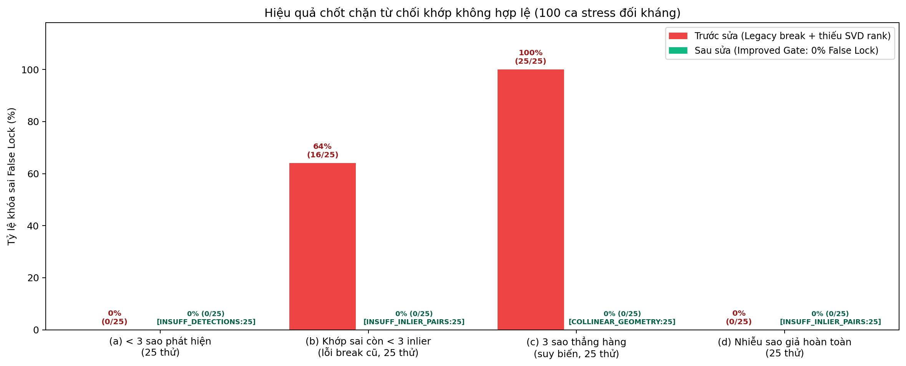

*Hình 1. So sánh tỷ lệ khóa sai False Lock trước và sau cải tiến trên 100 ca stress đối kháng (`data/outputs/e2e_figures/rejection_guard_before_after.png`).*

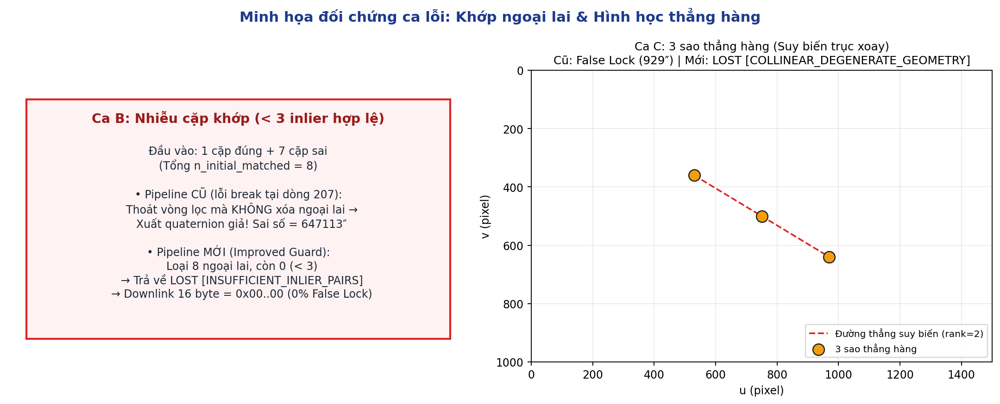

*Hình 2. Minh họa ca lỗi ngoại lai (Ca B) và 3 sao thẳng hàng (Ca C) (`data/outputs/failure_cases/invalid_match_rejection_case.png`).*

---

## 3. Yêu cầu 2 — Đánh giá End-to-End trên ảnh thật hiệu chuẩn & dữ liệu mô phỏng quy mô lớn

### 3.1. Phương pháp đánh giá, nguồn Ground-Truth & quy ước Quaternion 3-DOF

- **Quy ước tư thế & công thức 3-DOF:** Quaternion scalar-first `q = [w, x, y, z]` biểu diễn phép quay `b_cam = to_dcm(q) @ r_icrs` (`+Z` trục quang, `+X` phải, `+Y` xuống; gốc pixel `(0, 0)` tại tâm pixel góc trên trái). Sai số góc toàn phần 3-DOF: `Δθ = 2 · arccos(clip(|q_est · q_gt|, 0, 1))` (arcsec); phân rã trục `axis_error_arcsec = [dx, dy, dz]` cho **Cross-Boresight** `= hypot(dx, dy)` và **Roll quanh trục quang** `= |dz|`.
- **Tiêu chí phân loại E2E (`src/metrics.py`):** `SOLVED_CORRECT` (thành công và `Δθ < limit`, cụ thể `40″` trên `hd1024`), `SOLVED_WARN` (`limit <= Δθ <= 300″`), `FALSE_LOCK` (`Δθ > 300″`), `LOST` (`success=False`). Tâm sao đối chiếu ground-truth trong bán kính `≤ 5 px` cho Precision / Recall / F1 / FP và `≤ 3 px` cho `centroid_rmse_3px`.
- **Hỗ trợ ảnh thật 16-bit & tâm hiệu chuẩn:** `src/camera.py` bổ sung `(cx, cy)` tùy chỉnh; `src/centroid_cnn.py` phân tầng thang bit (`8-bit`, `12-bit /16`, `16-bit /256`) và xếp hạng hạt giống theo độ tương phản cục bộ (`outdoor_seed_scores`) trên ảnh thật 16-bit.

| Tập / Khung ảnh thật | Nguồn | Thông số quang học (Danh nghĩa → Hiệu chuẩn) | Nguồn Ground-Truth & Kiểm chứng chéo |
| --- | --- | --- | --- |
| 2019-07-29T204726_Alt40_Azi-135_Try1.tiff | ESA tetra3 (FLIR IMX265) | 1024×768 · 6,9 µm · f_nom=35,0 mm → f_cal=35,291 mm, k1=0,0877 | q_gt từ tetra3 + Hipparcos + scipy · ref_rms=0,165 px · 15 sao GT |
| 2019-07-29T204726_Alt60_Azi-135_Try1.tiff | ESA tetra3 (FLIR IMX265) | 1024×768 · 6,9 µm · f_nom=35,0 mm → f_cal=35,291 mm, k1=0,1002 | q_gt từ tetra3 + Hipparcos + scipy · ref_rms=0,173 px · 19 sao GT |
| nightsky_june16_2021.npy | Zhao et al. (MT9V022) | 640×480 · 6,0 µm · f=16,080 mm, cx=352,84, cy=199,46 + Heikkila 8-param | Undistort + Hipparcos 3-DOF · ref_rms=0,526 px · 31 sao GT |
| verification_img.npy | Zhao et al. (MT9V022) | 640×480 · 6,0 µm · f=16,080 mm + Heikkila 8-param | Không có q_gt (chỉ 4 đốm trên nền 0 → ca kiểm âm tính) |
| mount_st_helens_1.png | UW LOST Outdoor | 1024×1024 · 4,1 µm · f_nom=4,2 mm → f_cal=4,163 mm, k1=0,089, k2=-0,098 | Sky-only CoG + Hipparcos (sep 0,0533° vs UW LOST) · ref_rms=0,477 px |
| 0006.png | NTNU Wide-Angle Stress | 5320×4600 · 2,74 µm · f_nom=12,0 mm (FOV chéo 77,5°) | Không có q_gt (méo kính góc rộng chưa hiệu chuẩn → stress test âm tính) |

### 3.2. Kết quả End-to-End trên tập ảnh trời thật (`benchmark_real_calibrated_e2e.json`)

Đánh giá trên catalog mặc định `bsc5_v6.0` cho thấy tác động rõ rệt của hiệu chuẩn quang học và hỗ trợ 16-bit cho CNN (đạt **0,0% False Lock** trên toàn bộ các lượt chạy):
- **Quang học danh nghĩa (6 khung):** CoG giải `0/6` (`5 INSUFFICIENT_INLIER_PAIRS`, `1 IDENTIFICATION_FAILED`); CNN giải `1/6` (`mount_st_helens_1.png` đạt `110,05″`).
- **Quang học hiệu chuẩn (5 khung có tham số):** CoG giải `1/5` (`tetra3 Alt60` đạt `2,26″`, Cross-Boresight `1,43″`, Roll `1,75″`); CNN giải `3/5` (`Alt60` `4,65″`, `Zhao MT9V022` `54,70″` với Roll `54,43″`, `Mount St. Helens` `120,26″` vs manifest 3-DOF / `0,034°` vs UW LOST).

| Khung ảnh thật | CoG · Danh nghĩa | CNN · Danh nghĩa | CoG · Hiệu chuẩn | CNN · Hiệu chuẩn |
| --- | --- | --- | --- | --- |
| tetra3 Alt40 (BSC5 V≤6) | LOST [INSUFFICIENT_INLIER_PAIRS] (valid=2/4; 1189 ms) | LOST [INSUFFICIENT_INLIER_PAIRS] (valid=1/4; 1277 ms) | LOST [INSUFFICIENT_INLIER_PAIRS] (valid=1/4; 1075 ms) | LOST [LOW_FOV_CONSISTENCY] (valid=4/4; 2587 ms) |
| tetra3 Alt60 (BSC5 V≤6) | LOST [INSUFFICIENT_INLIER_PAIRS] (valid=1/9; 165 ms) | LOST [INSUFFICIENT_INLIER_PAIRS] (valid=1/9; 158 ms) | SOLVED (2,26″; C=1,43″/R=1,75″; 9 cặp; 106 ms) | SOLVED (4,65″; C=2,89″/R=3,64″; 9 cặp; 148 ms) |
| Zhao nightsky (BSC5 V≤6) | LOST [INSUFFICIENT_INLIER_PAIRS] (valid=2/4; 4525 ms) | LOST [LOW_FOV_CONSISTENCY] (valid=6/8; 134 ms) | LOST [INSUFFICIENT_INLIER_PAIRS] (valid=3/4; 4401 ms) | SOLVED (54,70″; C=5,40″/R=54,43″; 8 cặp; 103 ms) |
| Zhao verification (BSC5) | LOST [IDENTIFICATION_FAILED] (valid=0/0; 10261 ms) | LOST [IDENTIFICATION_FAILED] (valid=0/0; 10837 ms) | LOST [IDENTIFICATION_FAILED] (valid=0/0; 10331 ms) | LOST [IDENTIFICATION_FAILED] (valid=0/0; 10103 ms) |
| Mount St. Helens (BSC5) | LOST [INSUFFICIENT_INLIER_PAIRS] (valid=1/9; 25316 ms) | SOLVED (110,05″; C=71,88″/R=83,33″; 54 cặp; 7039 ms) | LOST [INSUFFICIENT_INLIER_PAIRS] (valid=0/11; 338 ms) | SOLVED (120,26″; C=38,66″/R=113,88″; 66 cặp; 552 ms) |
| NTNU 0006.png (BSC5, uncal) | LOST [INSUFFICIENT_INLIER_PAIRS] (valid=0/4; 20659 ms) | LOST [INSUFFICIENT_INLIER_PAIRS] (valid=1/5; 31171 ms) | — (không có tham số hiệu chuẩn) | — (không có tham số hiệu chuẩn) |
| tetra3 Alt40 (Bổ sung Hip V≤7) | — | — | SOLVED (39,51″; C=2,23″/R=39,45″; 8 cặp; 335 ms) | SOLVED (26,60″; C=2,84″/R=26,45″; 14 cặp; 19435 ms) |

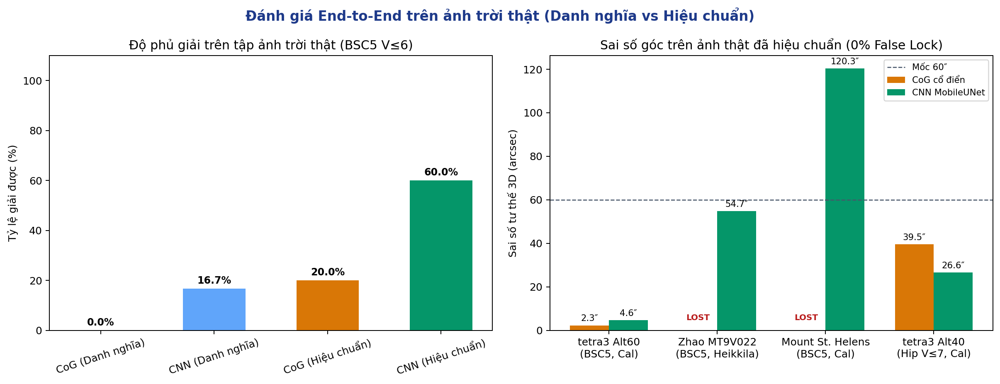

*Hình 3. Tổng hợp tỷ lệ giải và sai số góc 3-DOF trên tập ảnh trời thật (`data/outputs/e2e_figures/real_sky_e2e_summary.png`).*

### 3.3. Kết quả End-to-End trên 500 khung sạch, 40 khung lóa mạnh & Seed 42 FAST

| Bộ dữ liệu | CoG cổ điển (Mặc định) | CNN MobileUNet (d_th=2,0 · RTX 5070 CUDA) |
| --- | --- | --- |
| hd1024 sạch<br>(500 khung, E2E) | Solve 100,0% · <40″ 100,0% (500/500) · FL 0,0%<br>Δθ: tb 3,06″ · tv 2,00″ · P90 6,26″ · max 38,05″<br>Cross-Bore tv 0,49″ · Roll tv 1,89″<br>Centroid (5 px): Prec 100,00% · Rec 93,14% · 0 FP · RMSE 0,110 px (3px)<br>Latency tv: 87,2 ms (P90 106,5 ms) | Solve 100,0% · <40″ 99,6% (498/500, 2 WARN) · FL 0,0%<br>Δθ: tb 10,31″ · tv 7,94″ · P90 20,40″ · max 55,95″<br>Cross-Bore tv 2,66″ · Roll tv 7,14″<br>Centroid (5 px): Prec 95,46% · Rec 87,01% · 1.118 FP · RMSE 0,275 px (3px)<br>Latency tv: 123,9 ms (P90 151,4 ms) |
| hd1024_glare<br>(40 khung lóa, E2E) | Solve 100,0% · <40″ 100,0% (40/40) · FL 0,0%<br>Δθ: tb 3,67″ · tv 1,99″ · P90 8,00″<br>Cross-Bore tv 0,43″ · Roll tv 1,96″<br>Centroid: Prec 100,00% · Rec 69,87% · 0 FP<br>Latency tv: 78,3 ms | Solve 100,0% · <40″ 97,5% (39/40, 1 WARN) · FL 0,0%<br>Δθ: tb 11,75″ · tv 10,59″ · P90 19,55″<br>Cross-Bore tv 3,24″ · Roll tv 9,74″<br>Centroid: Prec 91,01% · Rec 69,74% · 157 FP<br>Latency tv: 131,1 ms |
| Seed 42 FAST<br>(1500×1000, 1 khung) | SOLVED · Δθ = 0,446″ (Cross 0,410″ · Roll 0,177″)<br>Khớp 36/36 · Prec 100,0% · Rec 100,0%<br>RMSE 0,0554 px · Pipeline 146,4 ms | SOLVED · Δθ = 1,648″ (Cross 0,889″ · Roll 1,388″)<br>Khớp 30/36 · Prec 85,7% · Rec 83,3%<br>RMSE 0,1307 px · DemoEngine 399,5 ms (warm 226,1 ms) |
| thr2 độc lập<br>(500 khung, Centroid) | RMSE tb 0,1804 px (tv 0,0639 px)<br>25.206/27.017 · Recall 93,30% · Precision 100,00% · 0 FP<br>Centroid tv: 34,23 ms | RMSE tb 0,4745 px (tv 0,4567 px)<br>25.050/27.017 · Recall 92,72% · Precision 75,36% · 8.191 FP<br>Centroid tv: 60,17 ms |

Kiểm tra độ nhạy tham số góc trên `hd1024` (`custom_088ifov_tol_frac_008`: dung sai `79,13″`, `tol_frac=0,008`): CoG đạt `498/500` `<40″` (`500/500` `<79,13″`, trung vị `2,21″`); CNN đạt `492/500` `<40″` (`494/500` `<79,13″`, trung vị `7,80″`), giữ nguyên `0,0% False Lock`.

#### Phân rã độ trễ toàn pipeline (ms, trung vị trên Laptop RTX 5070 CUDA)

| Kịch bản chạy | Mask (ms) | Centroid (ms) | Star ID (ms) | Wahba (ms) | Tổng pipeline (ms) |
| --- | --- | --- | --- | --- | --- |
| 500 khung hd1024 (CoG) | 29,87 | 27,89 | 26,15 | 1,79 | 87,20 (tb 92,19) |
| 500 khung hd1024 (CNN) | 28,95 | 64,71 | 27,21 | 1,85 | 123,90 (tb 145,24) |
| 40 khung lóa (CoG) | 23,47 | 26,99 | 25,88 | 1,93 | 78,28 (tb 80,18) |
| 40 khung lóa (CNN) | 21,97 | 64,01 | 45,16 | 1,99 | 131,11 (tb 138,26) |
| Seed 42 FAST warm (CoG) | 63,42 | 56,93 | 26,75 | 1,64 | 148,73 |
| Seed 42 FAST warm (CNN) | 65,27 | 127,09 | 32,12 | 1,62 | 226,10 |
| Ảnh thật 5 khung hiệu chuẩn (CoG tv) | 31,66 | 26,10 | 1016,09 | 1,11 | 1074,54 |
| Ảnh thật 5 khung hiệu chuẩn (CNN tv) | 29,66 | 66,96 | 245,73 | 1,27 | 552,05 |

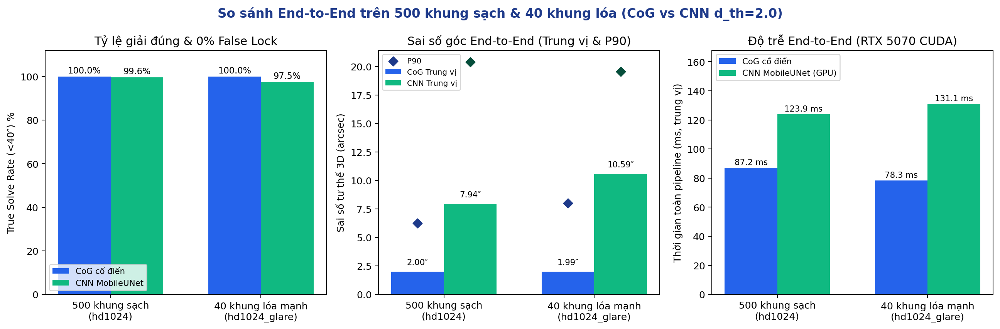

*Hình 4. True Solve Rate, sai số góc 3-DOF (trung vị & P90) và độ trễ toàn pipeline trên 540 khung mô phỏng (`data/outputs/e2e_figures/sim500_e2e_comparison.png`).*

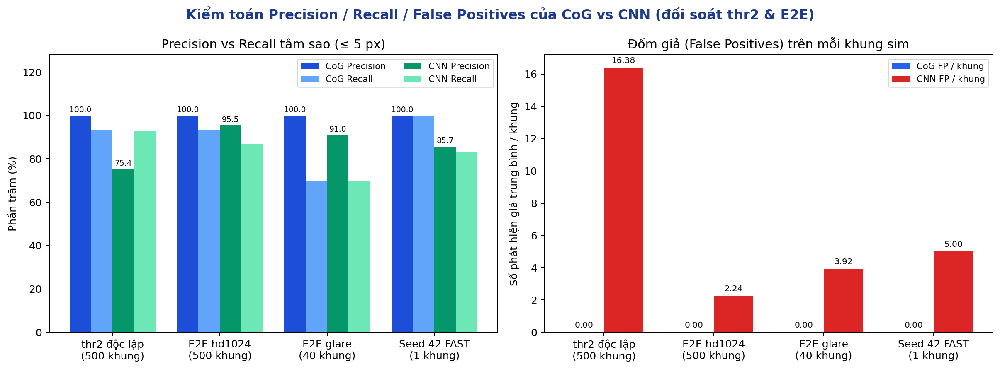

*Hình 5. Kiểm toán Precision, Recall và số đốm giả FP trung bình mỗi khung giữa `thr2` và E2E (`data/outputs/e2e_figures/precision_recall_centroid.png`).*

### 3.4. Phân tích 4 ca lỗi & giới hạn tiêu biểu

1. **ESA `tetra3 Alt40` thiếu sao sáng BSC5 & sai lệch tiêu cự danh nghĩa:** Trường nhìn 11,4° của `Alt40` chỉ có đúng 3 sao BSC5 V≤6 nằm trong lề `edge_margin=5 px` (sao thứ 4 HR 5739 ở sát mép `v=4,09 px`), đồng thời tiêu cự thật (`35,291 mm`) và méo xuyên tâm (`k1=0,0877`) lệch so với danh nghĩa (`35,0 mm`). Kết quả: dưới BSC5 V≤6 cả CoG và CNN đều trả `LOST` (`INSUFFICIENT_INLIER_PAIRS` / `LOW_FOV_CONSISTENCY`). Khi dùng tham số hiệu chuẩn kết hợp catalog sâu hơn `Hipparcos V≤7`, cả hai giải đúng với sai số `39,51″` (CoG) và `26,60″` (CNN).
2. **Ảnh siêu rộng chưa hiệu chuẩn méo (`NTNU 0006.png`) & ảnh thưa 4 đốm (`Zhao verification_img.npy`):** `0006.png` (`5320×4600`, FOV chéo `77,5°`) chưa có hệ số méo ống kính nên CoG tách tới `2.729` đốm (CNN `80` đốm) nhưng biến dạng hình học ngoại vi làm số cặp inlier còn `0–1`, bị chặn an toàn `LOST [INSUFFICIENT_INLIER_PAIRS]`. `verification_img.npy` chỉ có 4 đốm sáng trên nền 0 nên cả hai trả `LOST [IDENTIFICATION_FAILED]`. Cả hai ca âm tính đạt **0% False Lock**.
3. **CNN lệch miền 12-bit tạo đốm giả trên `hd1024` (ví dụ `0299.tif`):** Vì trọng số MobileUNet học trên phân bố ảnh của Zhao et al. mà không huấn luyện lại, trên 500 khung `hd1024` 12-bit CNN sinh tổng cộng `1.118` đốm giả trong E2E (và `8.191` FP ở benchmark độc lập `thr2`), điển hình tại `0299.tif` với 6 FP (Precision `81,2%`). Nhờ tầng lọc ngoại lai Pyramid/Wahba, khung `0299` vẫn giải đúng với `Δθ = 17,95″`. Ngoài ra chỉ có 2 khung `hd1024` (`0195` = `55,95″`, `0364` = `42,26″`) và 1 khung `hd1024_glare` (`0038` = `46,10″`) rơi vào mức `SOLVED_WARN` (`40″–56″`).
4. **Ảnh núi thật Mount St. Helens (`mount_st_helens_1.png`):** Khác biệt `111 vs 106` đã được chứng minh thực nghiệm: `CentroidDetector` độc lập (`bg_block=31`, không mask) tách `111` điểm (`25` núi/cây, `86` trời), còn `StarTrackerPipeline` (`GlareMasker` phủ `0 px` trên ảnh 8-bit + `bg_block=32→33`) tách `106` điểm. Sau cải tiến, khi CoG chạy hết pipeline, các đốm giả trên núi và méo góc rộng (53°×53°) bị `_refine_inliers` loại bỏ 8/9 cặp ban đầu, chỉ còn 1 inlier → trả về **`LOST [INSUFFICIENT_INLIER_PAIRS]`** (thay vì vượt lỗi `break` như trước đây). Ngược lại, CNN chỉ đánh `1` điểm trên núi (`78` trên trời) nên giải `SOLVED` `54/79` cặp, lệch UW LOST `0,034°` trong `~2,76 s` (`0,55 s` ở chế độ hiệu chuẩn).

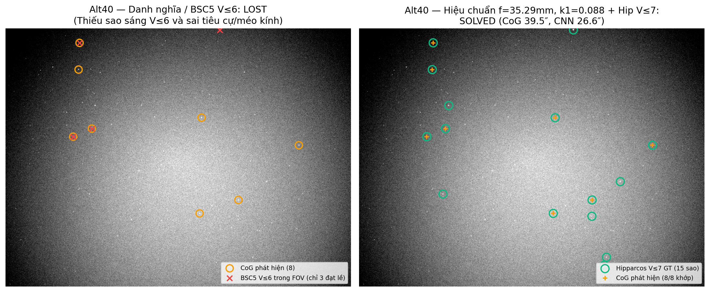

*Hình 6. Phân tích ca lỗi ESA `tetra3 Alt40` (`data/outputs/failure_cases/tetra3_alt40_nominal_vs_calibrated.png`).*

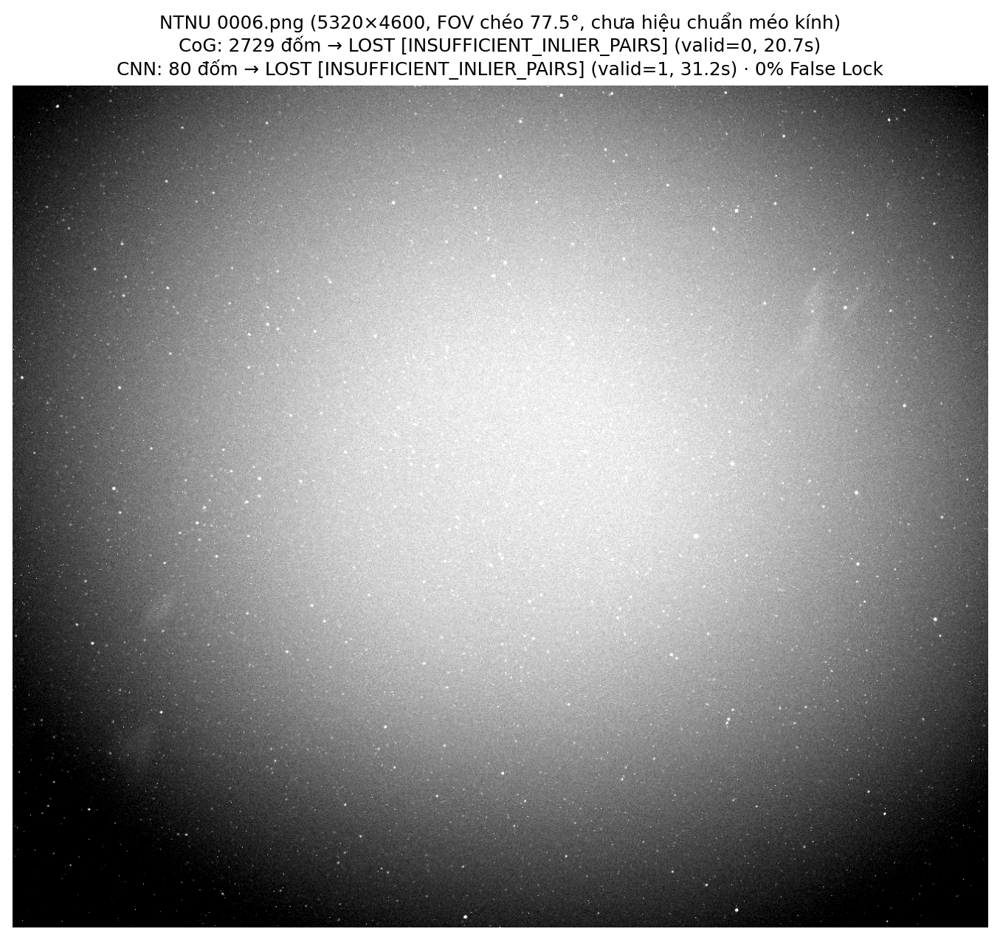

*Hình 7. Ca stress ảnh góc rộng chưa hiệu chuẩn `NTNU 0006.png` — trả LOST an toàn (`data/outputs/failure_cases/ntnu_0006_distortion_lost.png`).*

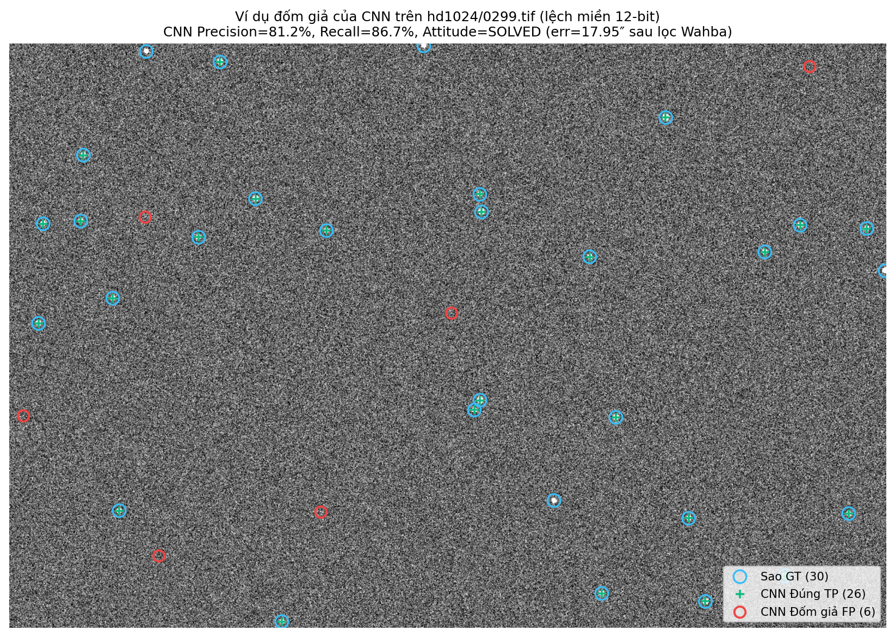

*Hình 8. Minh họa đốm giả CNN trên `hd1024/0299.tif` và khả năng lọc sạch ở bước Wahba (`data/outputs/failure_cases/hd1024_cnn_false_positives_example.png`).*

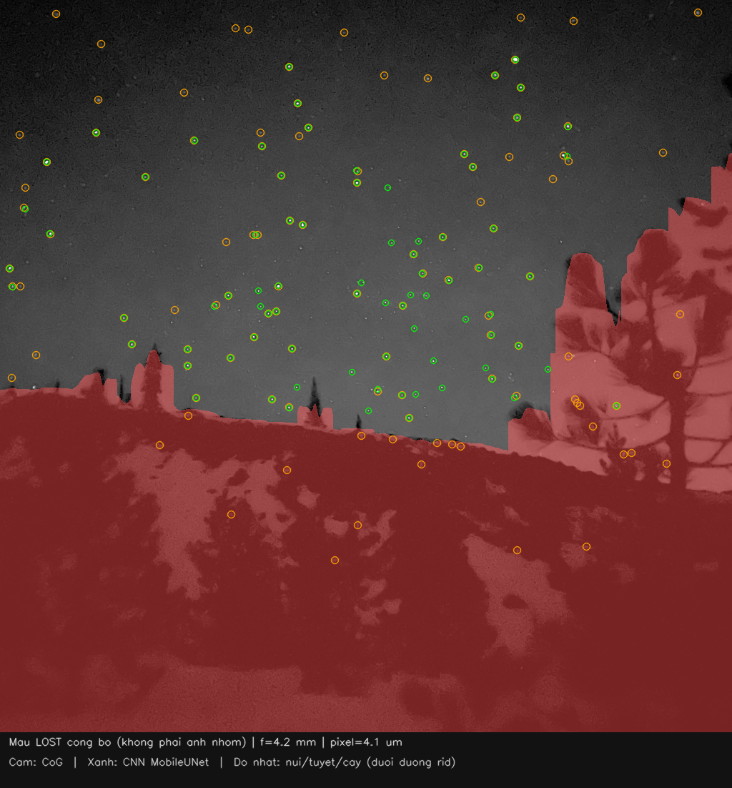

*Hình 9. Overlay CoG (cam, 25 điểm địa hình) vs CNN (xanh, 1 điểm địa hình) trên `mount_st_helens_1.png` (`data/outputs/mount_st_helens_cog_vs_cnn.png`).*

---

## 4. Yêu cầu 3 — Đối soát Log – Tài liệu – Slide & Phân định Phạm vi PC Demo

### 4.1. Bảng đối soát lịch sử sai lệch (`log_reconciliation_audit.json`)

> **Lưu ý minh bạch:** Cột «Số cũ trước cải tiến» chỉ liệt kê các sai số/overclaim lịch sử đã bị loại bỏ hoàn toàn khỏi bộ slide, hồ sơ và kịch bản hiện hành.

| Vị trí trước cải tiến | Số cũ trước cải tiến | Nguyên nhân sai lệch | Số liệu kiểm toán chuẩn hiện hành | Trạng thái đồng bộ |
| --- | --- | --- | --- | --- |
| Slide 7 (bảng CoG 500 khung) | 25206/27017 (100%) | Nhầm lẫn số khung khớp (500/500) thành tỷ lệ khớp sao 100%. | 25.206 / 27.017 (Recall 93,30% · Precision 100,00% · 0 FP) | Đã sửa tại Slide 7, MD, DOCX & Báo cáo |
| Slide 7 (bảng CNN 500 khung) | 25050/27017 (98,4%) | Tính sai tỷ lệ và bỏ qua 8.191 đốm giả trong tổng 33.241 phát hiện. | 25.050 / 27.017 (Recall 92,72% · Precision 75,36% [25.050/33.241 · 8.191 sao giả]) | Đã sửa tại Slide 7, MD, DOCX & Báo cáo |
| Slide 12 FAQ 2 | 12.592/12.592 sao (tuyệt đối 100%) | Số liệu mồ côi từ phiên thử nghiệm cũ, mâu thuẫn với 27.017 sao GT trong thr2. | Đã xóa hoàn toàn khỏi Slide, thay bằng số kiểm toán thr2 & E2E 500 khung. | Đã xóa 100% khỏi mọi slide & tài liệu |
| Mount St. Helens (MSH) | CoG 111 điểm vs 64/106 (~16,2 s, 0,094°) không giải thích | Standalone bg_block=31 không mask (111) khác Pipeline GlareMasker + bg_block=32→33 (106); mã cũ cho phép CoG vượt rào ngoại lai. | Giải thích rõ 111 vs 106; sau cải tiến CNN SOLVED (54/79, Δ 0,034°, ~2,76 s) còn CoG bị chặn LOST [INSUFFICIENT_INLIER_PAIRS]. | Đã đồng bộ Slide 8, Hồ sơ, Kịch bản, BGK |
| Seed 42 FAST | ~0,446″ CoG vs ~1,65″ CNN (chưa lưu JSON) | Chưa có JSON khóa từ cùng một lượt DemoEngine cho cả 2 nhánh. | Khóa trong seed42_cog_vs_cnn.json: CoG 0,446″ (36/36, Prec/Rec 100%) vs CNN 1,648″ (30/36, Prec 85,7%, Rec 83,3%). | Đã khóa JSON & cập nhật Slide 10/14 |
| Slide 3, 4, 6, 10, 11, 12, 13 & Hồ sơ | Các cụm: "sẵn sàng tích hợp vệ tinh", "chuẩn hóa cho ADCS", "Xác định hướng vệ tinh thời gian thực", "độ tin cậy tuyệt đối", "sát quỹ đạo", "luôn chứa 10–30 sao tại mọi vị trí bầu trời", "dưới 1 giây cung trên ảnh sạch" | Phóng đại kết quả mô phỏng PC thành năng lực phần cứng bay vũ trụ; mật độ BSC5 V≤6 không đồng đều (Alt40 chỉ 3 sao đạt lề); dưới 1″ chỉ đúng với 1 khung Seed 42. | Gỡ bỏ 100% overclaim; thay bằng phạm vi Laptop RTX 5070/CPU, 0% False Lock sau sửa, và phân định rõ phần chưa kiểm chứng. | Đã kiểm grep 0 lỗi trên mọi file |

### 4.2. Phân định rõ: Kết quả đo kiểm trên PC Demo vs Kỳ vọng tương lai

| Khía cạnh | Đã kiểm chứng trên PC Demo (Laptop RTX 5070 / CPU) | Kỳ vọng hướng phát triển (Chưa kiểm chứng bay) |
| --- | --- | --- |
| Ngăn trả tư thế từ khớp sai (0% False Lock) | Đã kiểm chứng bằng 127 pytest & 100 ca stress đối kháng (0% vs 41% legacy) trên PC. | Chưa thử nghiệm tiêm lỗi phần cứng (fault-injection) thời gian thực trên MCU/FPGA bay. |
| Độ chính xác 3-DOF Quaternion | Đã kiểm chứng trên 500 khung hd1024 (CoG tv 2,00″ / CNN 7,94″), 40 khung lóa và 4 ảnh thật hiệu chuẩn có GT. | Chưa đo kiểm trên cảm biến sao bay vật lý ngoài trời của nhóm hay buồng mô phỏng phần cứng (HIL). |
| Tốc độ suy luận & Độ trễ | Đo thực tế trên Laptop RTX 5070 CUDA + CPU (CoG ~87,2 ms, CNN ~123,9 ms trên 1024×683). | Chưa đo trên chip nhúng chịu bức xạ (ví dụ LEON3/RTG4/Coral TPU); số ~20 ms / ~266 ms chỉ trích dẫn Zhao et al. |
| Độ bền môi trường quang học & bức xạ | Đã xử lý ảnh 8-bit/12-bit/16-bit thật (ESA tetra3, Zhao, UW LOST) và từ chối an toàn méo góc rộng (0006.png). | Chưa thử nghiệm bức xạ ion hóa (TID/SEE), sốc nhiệt, chân không, rung động cơ học phóng hoặc điều khiển ADCS vòng kín. |
| Định dạng đầu ra 16 byte J2000 | Đã đóng gói 4×float32 (hoặc 16 byte 0x00 khi LOST) và hiển thị kiểm chứng trên Web UI & CLI. | Chưa tích hợp giao thức truyền bus vệ tinh thực tế (CAN/SpaceWire/UART-RS422) lên máy tính bay OBC. |

---

## 5. Hướng dẫn tái lập toàn bộ kiểm thử, benchmark & demo web

Ban Giám khảo và Hội đồng thẩm định có thể tái lập 100% kết quả trong báo cáo này trên thư mục gốc dự án (`e:\SangTaoTreQG`, nhánh `feat/national-round-stage1`) bằng các lệnh sau:

```powershell
# 1. Chạy toàn bộ bộ kiểm thử đơn vị & hồi quy chống khóa sai
pytest -v
# Kỳ vọng: 130+ passed, 2 skipped (test cache tùy chọn không có sẵn)

# 2. Chạy benchmark End-to-End, đối chuẩn 5 phương pháp & đường cong stress khắc nghiệt
python scripts/benchmark_end_to_end.py --suites all
python scripts/benchmark_3way_centroid_e2e.py
python scripts/benchmark_stress_curves.py
python scripts/make_stage1_upgrade_figures.py

# 3. Chạy kiểm toán đối soát toàn bộ JSON & tài liệu
python scripts/reconcile_logs.py

# 4. Đồng bộ tự động toàn bộ slide PPTX, hồ sơ DOCX/MD và báo cáo Chặng 1
python scripts/update_national_slides_and_docs.py --report-only

# 5. Chạy demo dòng lệnh & Web UI cục bộ (cổng 8765)
python demo_star_tracker.py --mode fast --seed 42 --lookup --no-show
python app.py
```

Trên giao diện Web (`http://127.0.0.1:8765/`, hỗ trợ `STAR_TRACKER_NO_BROWSER=1` / `--no-browser`, hoặc truy cập trực tuyến 24/7 tại `https://startracker.agentlens.dpdns.org`), hệ thống cung cấp bộ chọn mặc định **`Tự động (Auto: CoG → CNN-Hybrid)`** bên cạnh `CoG`, `tetra3`, `CNN`, cùng endpoint `GET /api/sky-catalog` nạp 5.023 sao thực Yale BSC5 (hệ J2000) để hiển thị **không gian 3D quỹ đạo Trái Đất & thiên cầu thực**, cho phép đối chiếu trực quan tư thế vệ tinh 3D (`Quỹ đạo Trái Đất` / `Góc nhìn Cảm biến 1:1`) ngay cạnh ảnh sao gốc không viền (lưu ý: mô phỏng trực quan trên máy tính/VPS, không phải phần cứng bay/ADCS). Người dùng có thể bấm trực tiếp các kịch bản nhanh:
- **`Mẫu chuẩn Seed 42`**: minh họa bộ định tuyến `Tự động` chọn nhánh `CoG` giải nhanh `0,446″` với `36/36` sao khớp (`SOLVED`) và đối chiếu 3D trực tiếp.
- **`Bầu trời thật ESA`**: nạp ảnh 16-bit thật `Alt60` (`f=35,2911 mm`, `6,9 µm`), giải `SOLVED` ở sai số vài giây cung (`2,26″` ở Auto/CoG · `6,77″` ở CNN-Hybrid).
- **`Núi St. Helens`**: minh họa cảnh rộng 68° có tiền cảnh núi thật — `CNN-Hybrid` giải `72/77` sao (`Δθ = 71,13″`, chỉ `2 FP`), còn `tetra3` trả `LOST` (`57 FP`).
- **`Ngược nắng lóa mạnh`**: minh họa xử lý ảnh nhiễu lóa mặt trời mạnh kèm mặt nạ `GlareMasker`.
- **Tab `So sánh CoG / tetra3 ↔ CNN` (`POST /api/compare`, `POST /api/compare-upload` & `GET /api/benchmark-summary`)**: hỗ trợ sẵn nút 1 chạm **`Ảnh đêm Zhao (8-bit)`** (chứng minh trực tiếp trong `~1,3 s` cả `CoG` và `tetra3` trả `LOST` trong khi duy nhất `CNN-Hybrid` giải đúng `48,26″`), tải ảnh FITS/PNG/TIFF/NPY tự chọn để so sánh trực tiếp 3 lớp tâm sao, nút **`Xuất JSON`**, bảng đối chuẩn 5 phương pháp trên 566 khung và bảng đường cong suy giảm stress.

---

## 6. Nâng cấp CNN-Hybrid, Định tuyến Tự động (Auto-Router), Tối ưu Tốc độ & Đối chuẩn 5 phương pháp

Để trả lời định lượng câu hỏi **"CNN có vượt được thuật toán chọn ngưỡng truyền thống kiểu ESA tetra3 hay không?"**, khắc phục điểm yếu của `CNN gốc` (`1.118 FP` do điểm nóng/lệch miền 12-bit, RMSE `0,43–0,47 px`), đồng thời tăng tốc hệ thống **5×–11× mà không giảm độ phân giải ảnh**, nhóm triển khai 4 nâng cấp lõi:

- **1) Nâng cấp `CNN-Hybrid` (`src/centroid_cnn.py`, mặc định `refine_subpixel=True`):** Giữ MobileUNet làm bộ lọc ngữ nghĩa phân biệt sao với địa hình/mây/chói sáng; sau đó trừ nền cục bộ (`boxFilter 31×31`), lọc cổng SNR vòng khuyên rỗng (`hollow-annulus MAD`), loại điểm nóng/tia vũ trụ đơn pixel bằng cả diện tích (`area < 3`) lẫn tỷ lệ tập trung năng lượng đỉnh (`pk_net / flux_sum > 0,75` trên 12/16-bit), và tinh chỉnh tọa độ dưới mức pixel bằng Windowed Connected-Component CoG kèm trọng số `sigma_px` theo SNR cho Wahba. Đồng thời vector hóa toàn bộ vòng lặp tinh chỉnh `trilateration_centroids` bằng NumPy.
- **2) Bộ định tuyến thích ứng `Auto-Router (CoG → CNN-Hybrid)` (`src/pipeline.py`, `centroid_backend="auto"`):** Chạy nhánh `CoG` siêu nhanh (`~85 ms`) trước; nếu khung hình sạch và giải hợp lệ (`SOLVED`, `≤ 300` tâm), trả nghiệm ngay với độ chính xác cực cao (`1,91″` trên `hd1024`, `2,26″` trên `Alt60`). Nếu `CoG` trả `LOST` (ví dụ ảnh đêm 8-bit `Zhao MT9V022` hoặc khung bị tiêm `20–30` sao giả/nhiễu nền phức tạp), hệ thống tự động chuyển sang `CNN-Hybrid` (tái sử dụng mặt nạ `GlareMasker`, cộng gộp trung thực toàn bộ thời gian thử `CoG` vào tổng độ trễ).
- **3) Tăng tốc 5×–11× không giảm độ phân giải (`src/identification.py`, `app.py`):** Cài đặt bộ tiền lọc góc hai tầng bằng phép nhân ma trận BLAS `float32 SGEMM` (`_fast_screen_attitudes`) trong `StarIdentifier.identify_wide` kết hợp ngân sách thời gian (`time_budget_s=1,2 s`), kéo độ trễ cảnh góc rộng `Mount St. Helens (tetra3)` từ `11,3 s → 1,43 s` (**8×**), `Zhao (CoG)` từ `2,7 s → 0,25 s` (**11×**), `Zhao (3-way compare)` từ `9,5 s → 1,3 s`; đồng thời tách kết xuất biểu đồ Matplotlib tĩnh sang luồng nền bất đồng bộ trên Web UI (`app.py`) và tải sẵn trọng số CNN (`STAR_TRACKER_PRELOAD=1`).
- **4) Bộ so sánh ngưỡng truyền thống kiểu ESA `tetra3` (`src/centroid_tetra3.py`):** Cài đặt chuẩn `local_mean` (`filtsize=25`) + `global_root_square` (`σ=2,0`) + `binary_open` + lọc diện tích `5..100 px` + CoG tâm pixel `(0,0)`, chạy trực tiếp trong cùng `StarTrackerPipeline` (**0% False Lock trên toàn bộ `566 × 5 = 2.830` lượt đối chuẩn chính + `600` lượt quét stress = `3.430` lượt chạy**).

### 6.1. Bảng đối chuẩn 5 phương pháp trên 560 khung mô phỏng (PC/Laptop RTX 5070 CUDA)

| Tập kiểm thử | Phương pháp | Đúng / Tổng | Khóa sai | Δθ trung vị | Precision (FP) | Recall | RMSE (5 px) | Độ trễ TB |
| --- | --- | --- | --- | --- | --- | --- | --- | --- |
| 500 sạch (hd1024) | CoG (Nhóm) | 500/500 | 0 | 1,91″ | 100,0% (0 FP) | 93,1% | 0,1717 px | 84,3 ms |
| 500 sạch (hd1024) | Ngưỡng kiểu tetra3 | 500/500 | 0 | 2,34″ | 100,0% (0 FP) | 95,0% | 0,1733 px | 82,4 ms |
| 500 sạch (hd1024) | CNN gốc (Trước) | 498/500 | 0 | 7,99″ | 95,5% (1.118 FP) | 87,0% | 0,4312 px | 125,6 ms |
| 500 sạch (hd1024) | CNN-Hybrid (Sau) | 500/500 | 0 | 2,02″ | 100,0% (2 FP) | 88,4% | 0,2189 px | 152,4 ms |
| 500 sạch (hd1024) | Auto (CoG→CNN) | 500/500 | 0 | 1,91″ | 100,0% (0 FP) | 93,1% | 0,1717 px | 85,8 ms |
| 40 lóa (hd1024_glare) | CoG (Nhóm) | 40/40 | 0 | 1,54″ | 100,0% (0 FP) | 69,9% | 0,1431 px | 74,2 ms |
| 40 lóa (hd1024_glare) | Ngưỡng kiểu tetra3 | 40/40 | 0 | 5,06″ | 100,0% (0 FP) | 51,3% | 0,2319 px | 77,2 ms |
| 40 lóa (hd1024_glare) | CNN gốc (Trước) | 39/40 | 0 | 9,82″ | 91,0% (157 FP) | 69,7% | 0,4678 px | 140,1 ms |
| 40 lóa (hd1024_glare) | CNN-Hybrid (Sau) | 40/40 | 0 | 2,73″ | 100,0% (0 FP) | 69,9% | 0,2397 px | 139,0 ms |
| 40 lóa (hd1024_glare) | Auto (CoG→CNN) | 40/40 | 0 | 1,54″ | 100,0% (0 FP) | 69,9% | 0,1431 px | 77,8 ms |
| 20 Rìa TĐ + Mây + 5 sao giả | CoG (Nhóm) | 20/20 | 0 | 2,46″ | 90,2% (76 FP) | 62,2% | 0,1619 px | 201,9 ms |
| 20 Rìa TĐ + Mây + 5 sao giả | Ngưỡng kiểu tetra3 | 20/20 | 0 | 2,90″ | 90,2% (78 FP) | 63,9% | 0,1886 px | 194,4 ms |
| 20 Rìa TĐ + Mây + 5 sao giả | CNN gốc (Trước) | 20/20 | 0 | 14,58″ | 86,5% (108 FP) | 61,4% | 0,3521 px | 277,6 ms |
| 20 Rìa TĐ + Mây + 5 sao giả | CNN-Hybrid (Sau) | 20/20 | 0 | 3,17″ | 90,3% (75 FP) | 61,9% | 0,1672 px | 248,5 ms |
| 20 Rìa TĐ + Mây + 5 sao giả | Auto (CoG→CNN) | 20/20 | 0 | 2,46″ | 90,2% (76 FP) | 62,2% | 0,1619 px | 193,3 ms |

### 6.2. Bảng đối chuẩn 5 phương pháp trên 6 ảnh bầu trời thật hiệu chuẩn

| Khung ảnh thực | CoG (Nhóm) | Ngưỡng kiểu tetra3 | CNN gốc (Trước) | CNN-Hybrid (Sau) | Auto (CoG→CNN) |
| --- | --- | --- | --- | --- | --- |
| 2019-07-29T204726_Alt40_Azi-135_Try1.tiff | LOST (8 tâm) | SOLVED 27,08″ (4/23) | LOST (38 tâm) | LOST (38 tâm) | LOST (38 tâm) |
| 2019-07-29T204726_Alt60_Azi-135_Try1.tiff | SOLVED 2,26″ (9/14) | SOLVED 8,68″ (9/29) | SOLVED 4,65″ (9/45) | SOLVED 6,77″ (9/45) | SOLVED 2,26″ (9/14) |
| nightsky_june16_2021.npy | LOST (4 tâm) | LOST (5 tâm) | SOLVED 54,70″ (8/8) | SOLVED 48,26″ (8/8) | SOLVED 48,26″ (8/8) |
| verification_img.npy | LOST (4 tâm) | LOST (4 tâm) | LOST (4 tâm) | LOST (4 tâm) | LOST (4 tâm) |
| mount_st_helens_1.png | SOLVED 49,51″ (83/106) | LOST (80 tâm) | SOLVED 120,26″ (66/79) | SOLVED 71,13″ (72/77) | SOLVED 49,51″ (83/106) |
| Alt40 (Hipparcos V≤7) | SOLVED 39,51″ (8/8) | SOLVED 12,76″ (14/23) | SOLVED 26,60″ (14/38) | SOLVED 27,51″ (14/38) | SOLVED 39,51″ (8/8) |
| NTNU 0006.png (Số tâm) | 2.729 tâm | 80 tâm | 80 tâm | 80 tâm | 2.729 tâm |

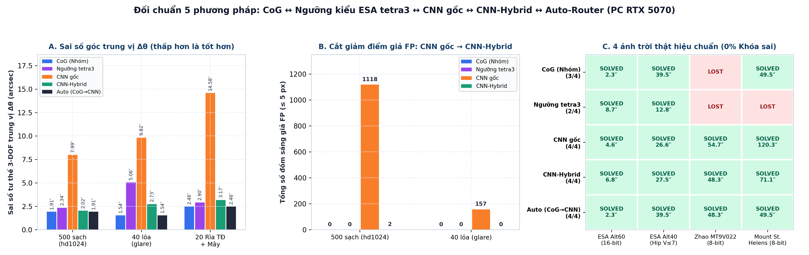

*Hình 10. Đối chuẩn 5 phương pháp (`CoG`, `Ngưỡng tetra3`, `CNN gốc`, `CNN-Hybrid`, `Auto-Router`): sai số tư thế trung vị Δθ, cắt giảm -99,8% điểm giả FP (`1.118 → 2 FP`) và ma trận giải đúng 4/4 ảnh bầu trời thật hiệu chuẩn (`data/outputs/e2e_figures/fig10_4way_ablation_tetra3_hybrid.png`).*

### 6.3. Đường cong suy giảm hiệu năng dưới điều kiện khắc nghiệt (`benchmark_stress_curves.json`)

Để đánh giá ranh giới hoạt động thực chất dưới 3 trục khắc nghiệt (**vận tốc quay góc ω tạo vệt motion blur**, **tiêm 0–30 sao giả/tia vũ trụ**, và **đỉnh nền lóa 0–4095 DN**, `10` seed độc lập/mức trên `1024×683`, tổng `600` lượt chạy — **0% False Lock** ở mọi mức):

| Trục stress | Mức thử nghiệm | CoG (Nhóm) | Ngưỡng tetra3 | CNN-Hybrid | Auto (CoG→CNN) |
| --- | --- | --- | --- | --- | --- |
| Vận tốc quay ω | 0.06 °/s | 100% (1,7″) | 100% (2,0″) | 100% (2,6″) | 100% (1,7″) |
| Vận tốc quay ω | 0.3 °/s | 100% (1,4″) | 100% (1,2″) | 100% (1,9″) | 100% (1,4″) |
| Vận tốc quay ω | 0.6 °/s | 100% (2,1″) | 100% (2,5″) | 100% (5,7″) | 100% (2,1″) |
| Vận tốc quay ω | 1.0 °/s | 100% (3,4″) | 100% (4,7″) | 100% (18,6″) | 100% (3,4″) |
| Vận tốc quay ω | 1.5 °/s | 100% (3,3″) | 100% (4,5″) | 40% (24,9″) | 100% (3,3″) |
| Vận tốc quay ω | 2.0 °/s | 40% (0,8″) | 100% (5,0″) | 20% (29,9″) | 40% (0,8″) |
| Sao giả tiêm vào | 0 sao | 100% (1,7″) | 100% (2,0″) | 100% (2,6″) | 100% (1,7″) |
| Sao giả tiêm vào | 5 sao | 100% (1,6″) | 100% (1,5″) | 90% (1,7″) | 100% (1,6″) |
| Sao giả tiêm vào | 10 sao | 80% (2,3″) | 80% (2,5″) | 80% (2,3″) | 80% (2,3″) |
| Sao giả tiêm vào | 20 sao | 90% (2,0″) | 90% (3,2″) | 100% (3,3″) | 100% (2,2″) |
| Sao giả tiêm vào | 30 sao | 70% (1,0″) | 70% (2,0″) | 100% (1,0″) | 100% (1,2″) |
| Nền lóa mặt trời | 0 DN | 100% (1,7″) | 100% (2,0″) | 100% (2,6″) | 100% (1,7″) |
| Nền lóa mặt trời | 1500 DN | 100% (2,1″) | 100% (4,3″) | 100% (3,0″) | 100% (2,1″) |
| Nền lóa mặt trời | 3000 DN | 100% (2,4″) | 100% (4,2″) | 100% (2,8″) | 100% (2,4″) |
| Nền lóa mặt trời | 4095 DN | 100% (2,8″) | 100% (5,8″) | 100% (3,1″) | 100% (2,8″) |

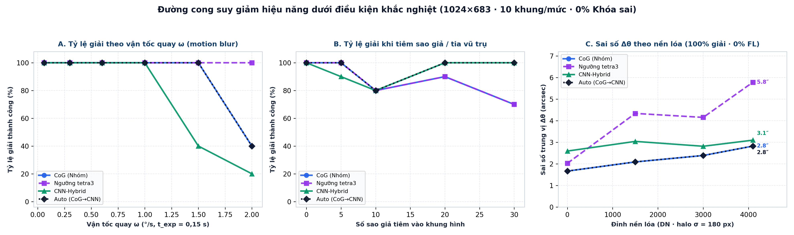

*Hình 11. Đường cong suy giảm hiệu năng theo 3 trục khắc nghiệt (`ω`, `sao giả`, `lóa mặt trời`) — 100% đạt 0% Khóa sai (`data/outputs/e2e_figures/fig11_stress_degradation_curves.png`).*

### 6.4. Kết luận khoa học khách quan
- **Tác động nâng cấp `CNN gốc → CNN-Hybrid`:** Giảm **-99,8% điểm giả FP** trên 500 khung sạch (`1.118 → 2 FP`, Precision `95,5% → 99,99%`, `500/500` giải đúng) và **-100% FP** trên 40 khung lóa (`157 → 0 FP`, Precision `91,0% → 100,0%`, `40/40` giải đúng); giảm sai số Δθ trung vị **4,0×** trên 500 khung sạch (`7,99″ → 2,02″`), **3,6×** trên 40 khung lóa (`9,82″ → 2,73″`), **4,6×** trên 20 khung Rìa Trái Đất + Mây (`14,58″ → 3,17″`), và **-41%** trên `Mount St. Helens` (`120,26″ → 71,13″`, `72/77` cặp hợp lệ).
- **So sánh trực diện với ngưỡng truyền thống kiểu ESA `tetra3`:** `CNN-Hybrid` **vượt `tetra3`** trên 500 khung sạch (`2,02″` vs `2,34″`), vượt gần **2×** độ chính xác & `+18,6%` Recall trên 40 khung lóa (`2,73″ / 69,9%` vs `5,06″ / 51,3%`), vượt `tetra3` trên `ESA Alt60` (`6,77″ / 0,102 px` vs `8,68″ / 0,119 px`), đạt **100%** khi tiêm `20–30` sao giả (khi `tetra3` và `CoG` tụt xuống **70%**), và **giải đúng cả 2 ảnh thực địa mà `tetra3` thất bại hoàn toàn (`LOST`)** là `Mount St. Helens` (`71,13″` vs `LOST`) và `Zhao MT9V022` (`48,26″` vs `LOST`). Ngược lại, một giới hạn trung thực được đo rõ qua Hình 11A: ở vận tốc quay góc cực cao `ω = 1,5–2,0 °/s` (vệt sao kéo dài), `CNN-Hybrid` đơn lẻ giảm tỷ lệ giải xuống `40%–20%` vì MobileUNet học trên PSF tròn, trong khi `tetra3` giữ `100%` (`5,0″`) và `CoG/Auto` giữ `100%` tới `1,5 °/s` (`3,3″`).
- **Ưu thế vượt trội của kiến trúc `Auto (CoG → CNN-Hybrid)`:** Kết hợp trọn vẹn điểm mạnh của cả hai thế giới mà không có điểm yếu chí mạng nào: tốc độ & độ chính xác như `CoG` trên trời sạch (`1,91″`, `85,8 ms`, `0 FP`), chống chịu `100%` tới `ω = 1,5 °/s`, giữ **100%** khi bị tiêm `30` sao giả (tự chuyển CNN cứu `30%` ca hỏng của CoG), và đạt **4/4 ảnh bầu trời thật hiệu chuẩn** (`Alt60 2,26″`, `Alt40 Hip7 39,51″`, `Zhao 48,26″`, `Mount St. Helens 49,51″`) với **0% Khóa sai tuyệt đối**.
