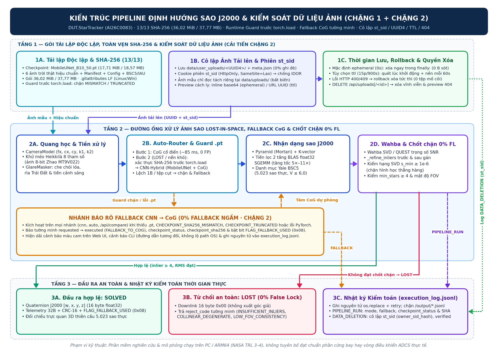
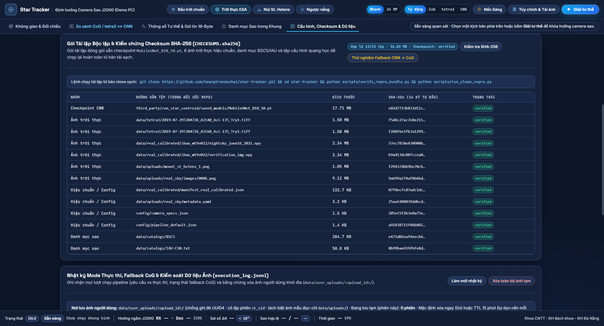
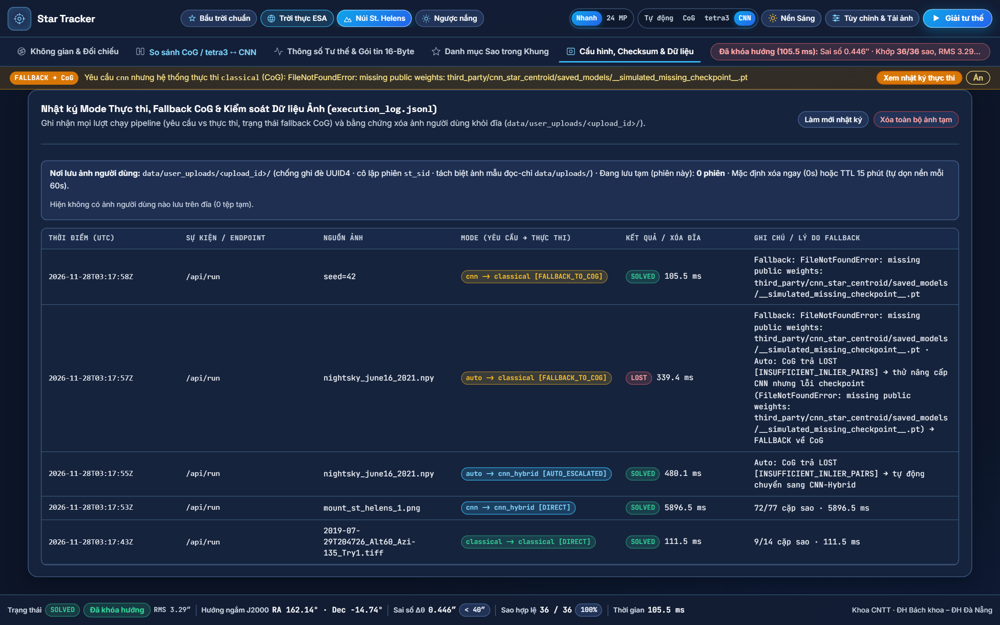

# BÁO CÁO CẢI TIẾN VÒNG CHUNG KẾT · CHẶNG 2 (HACKATHON)

**Cuộc thi Sáng tạo trẻ Quốc gia trong lĩnh vực Trí tuệ nhân tạo năm 2026 (Bảng C)**  
**Đội thi:** `DUT.StarTracker` (`AI26C0083`) — Trường Đại học Bách khoa, Đại học Đà Nẵng (Khoa Công nghệ thông tin)  
**Đề tài:** *Star Tracker — Hệ thống định hướng camera bầu trời sao lai CoG | CNN (Demo nghiên cứu trên PC)*  
**Ngày nộp:** `28/11/2026` · **Phiên bản mã nguồn:** `v1.2.0-stage2` (nhánh `main`, commit `c66435b`)  

---

## 1. Phân tích vấn đề của Đề cải tiến Chặng 2 (Phiên bản 1)

Theo đề bài Chặng 2 (**"1. Tái lập pipeline và kiểm soát dữ liệu ảnh"**), hệ thống sau Chặng 1 tồn tại hai lỗ hổng quan trọng cần khắc phục triệt để trong thời gian Hackathon:

1. **Chưa đủ gói tái lập độc lập từ bản tải sạch:** Trong `.gitignore` trước đây, trọng số `third_party/cnn_star_centroid/saved_models/MobileUNet_B10_50.pt` (18,57 MB) và các ảnh bầu trời thật hiệu chuẩn (`Alt40`, `Alt60`, `nightsky_june16_2021.npy`, `verification_img.npy`, `mount_st_helens_1.png`, `0006.png`) đều bị loại trừ khỏi kho Git; chưa có tệp `CHECKSUMS.sha256` chuẩn để đối soát tính toàn vẹn và chưa có quy trình 1 lệnh tự động xác minh lại từ một bản `git clone` sạch.
2. **Mâu thuẫn giữa cam kết dữ liệu ảnh và mã nguồn thực tế + thiếu cảnh báo fallback tường minh:**
   - Tại Hồ sơ dự án (`[StarTracker] - Hồ sơ dự án.docx`, đoạn P184), tài liệu ghi *"Giao diện không có tài khoản người dùng và không lưu ảnh người xem"*, trong khi thực tế mã nguồn `app.py` (ở các route `/api/run-upload` và `/api/compare-upload`) lại ghi trực tiếp tệp ảnh và tệp sidecar `.json` vĩnh viễn vào `data/uploads/<safe_name>`.
   - Cách ghi phẳng này gây ra **3 rủi ro đồng thời**: (a) lưu vĩnh viễn ảnh người dùng không có thời hạn xóa hay nút xóa, (b) **ghi đè lẫn nhau** khi 2 người dùng tải tệp trùng tên, và (c) **nguy cơ ghi đè ảnh mẫu kiểm chuẩn** (ví dụ tải tệp mang tên `mount_st_helens_1.png` sẽ phá hủy tệp mẫu trong `data/uploads/`).
   - Khi yêu cầu chạy `CNN` nhưng thiếu trọng số hoặc lỗi suy luận, hệ thống chỉ đổi nhãn nhỏ trong text trạng thái mà chưa có **nhật ký cấu trúc phân biệt chế độ yêu cầu vs thực thi** (`requested_backend` vs `executed_backend`) và chưa có dải cảnh báo `FALLBACK → CoG` nổi bật kèm nguyên nhân cụ thể.

---

## 2. Thiết kế & Triển khai Giải pháp Cải tiến Chặng 2

### 2.1. Gói Tái lập Độc lập kèm Checksum SHA-256 (`CHECKSUMS.sha256` & `REPRODUCIBILITY.md`)

- **Đóng gói đầy đủ vào kho Git (không cần Git LFS):** Cập nhật `.gitignore` với danh sách ngoại lệ tường minh để theo dõi đúng **13 tệp cốt lõi (`36.03 MB` tổng cộng, tệp lớn nhất `18,57 MB < 100 MB`)** gồm checkpoint `MobileUNet_B10_50.pt`, 6 ảnh bầu trời thật hiệu chuẩn, 2 manifest hiệu chuẩn (`manifest_real_calibrated.json`, `metadata.yaml`), 2 tệp cấu hình quang học/pipeline (`camera_specs.json`, `pipeline_default.json`) và 2 tệp danh mục sao (`BSC5`, `IAU-CSN.txt`). Đồng thời loại trừ tuyệt đối thư mục tạm của người dùng (`data/user_uploads/`).
- **Kiểm chứng toàn vẹn SHA-256 (`src/repro_bundle.py`, `scripts/verify_repro_bundle.py`, `CHECKSUMS.sha256` & `src/centroid_cnn.py`):** Bảng checksum định dạng chuẩn GNU `sha256sum`, kiểm tra được bằng cả `python scripts/verify_repro_bundle.py`, `sha256sum -c CHECKSUMS.sha256`, API `GET /api/repro-status`, và đặc biệt **xác thực SHA-256 ngay trong runtime trước khi `torch.load(..., weights_only=False)`** (chặn tuyệt đối checkpoint hỏng/bị sửa 1 byte và kích hoạt fallback CoG an toàn).
- **Tái lập 1 lệnh & CLI đủ tham số quang học (`scripts/run_clean_repro.py`, `demo_star_tracker.py`, `REPRODUCIBILITY.md`):** Hỗ trợ đầy đủ cờ CLI `--focal-mm`, `--pixel-um`, `--k1`, `--k2`, `--sidecar`, `--simulate-cnn-fallback`; lệnh benchmark `benchmark_3way_centroid_e2e.py --real-only` và `run_clean_repro.py` chạy thông suốt từ bản `git clone` trống.

### 2.2. Minh bạch Chế độ Thực thi & Cảnh báo Fallback CoG (`src/execution_log.py`, `src/demo_session.py`, `demo_star_tracker.py`)

- **Phân biệt tường minh `requested_backend` vs `executed_backend`:** Mọi phản hồi từ `DemoEngine.run()`, `DemoEngine.compare()`, `app.py` và CLI `demo_star_tracker.py` đều trả về rõ 5 trường kiểm toán: `requested_backend`, `executed_backend`, `execution_mode_summary` (ví dụ `cnn -> classical [FALLBACK_TO_COG]`, `auto -> cnn_hybrid [AUTO_ESCALATED]`, `classical -> classical [DIRECT]`), `fallback_reason` và `checkpoint_status` (kiểm tra thực tế `weights_available()` trên cả `/api/run`, `/api/compare`, `/api/run-upload`, `/api/compare-upload`).
- **Cơ chế kiểm chứng Fallback an toàn (không làm hỏng tệp trọng số thật):** Bổ sung cờ `simulate_missing_weights` trên API `/api/run`, cờ `--simulate-cnn-fallback` trên CLI và nút 1 chạm **"Thử nghiệm Fallback CNN → CoG"** trên giao diện Web để điều hướng riêng phiên kiểm thử tới đường dẫn không tồn tại (`__simulated_missing_checkpoint__.pt`), kích hoạt đúng nhánh ngoại lệ `FileNotFoundError → CoG` thực tế mà không ảnh hưởng bộ nhớ đệm CNN của người dùng khác.
- **Nhật ký kiểm toán JSONL nguyên tử (`data/outputs/execution_log.jsonl`) & Dải cảnh báo trực quan:** Mọi lượt chạy pipeline (`PIPELINE_RUN`) và mọi thao tác xóa ảnh (`DATA_DELETION`) đều được ghi bằng cơ chế ghi tệp tạm + `os.replace` nguyên tử (hiển thị trực tiếp trên Tab **Cấu hình, Checksum & Dữ liệu** và truy xuất qua `GET /api/execution-log`). Khi `centroid_fallback=True`, thanh cảnh báo **`FALLBACK → CoG`** nổi bật màu hổ phách xuất hiện ngay dưới thanh điều hướng kèm lý do lỗi và nút nhảy tới Nhật ký thực thi.

### 2.3. Kiểm soát Dữ liệu Ảnh Người dùng, Chống ghi đè & Quyền xóa (`src/upload_store.py`)

| Thuộc tính kiểm soát | Trước Chặng 2 (`app.py` cũ) | Sau Chặng 2 (`src/upload_store.py`) |
|---|---|---|
| **Vị trí lưu ảnh tải lên** | Ghi phẳng vào `data/uploads/<safe_name>` (chung thư mục ảnh mẫu) | Cách ly hoàn toàn vào **`data/user_uploads/<upload_id>/`** (UUID4 16 ký tự hex, tách khỏi ảnh mẫu đọc-chỉ `data/uploads/`) |
| **Chống ghi đè & Cô lập phiên** | Ghi đè trực tiếp khi trùng tên (có thể phá hủy `mount_st_helens_1.png`) | **0% nguy cơ ghi đè**: mỗi lượt tải tạo thư mục `upload_id` riêng (`mkdir(exist_ok=False)`) + cookie phiên `st_sid` (`HttpOnly`, `SameSite=Lax`) ngăn trình duyệt khác xem/xóa chéo |
| **Thời gian lưu mặc định** | Lưu vĩnh viễn trên đĩa & ghi đè `demo_*.png` | **`retention_mode=ephemeral` (mặc định): 0 giây / 0 byte lưu đĩa** — preview trả inline `data:image/png;base64`, xóa vĩnh viễn ảnh + sidecar + preview trong `finally:` (`verified_gone_on_disk=True`) |
| **Chế độ lưu tạm tùy chọn & Rollback lỗi** | Không có | **`retention_mode=ttl`: lưu tạm tối đa 15 phút (`900 s`)**, cách ly cả 4 ảnh xem trước tại `/api/uploads/<id>/preview/<name>`, luồng nền tự dọn mỗi `60s`, tự động xóa rollback nếu lỗi HTTP 400/409 |
| **Quyền kiểm tra & Xóa tức thì** | Không có API hoặc nút xóa | Giao diện quản lý ảnh tạm + 4 REST API (`GET /api/uploads`, `GET /api/uploads/<id>/preview/<name>`, `DELETE /api/uploads/<id>`, `DELETE /api/uploads` — sau xóa preview trả `404` ngay) |
| **Nhất quán với Hồ sơ dự án** | Mâu thuẫn (*"không lưu ảnh người xem"*) | Đã đồng bộ 100% P184 trong `[StarTracker] - Hồ sơ dự án.docx`, `AI2026_Ho-so-du-an_StarTracker.docx/.md`, `README.md`, `REPRODUCIBILITY.md` và công bố trực tiếp ngay tại khung tải ảnh trên Web |

---

## 3. Kết quả Kiểm chứng Thực tế (Before vs After)

### 3.1. Xác thực Gói Tái lập & Chạy từ bản `git clone` sạch

- **Kiểm tra SHA-256 (`CHECKSUMS.sha256`):** **`13/13` tệp hợp lệ (`36.03 MB`)**, `MobileUNet_B10_50.pt` khớp đúng mã băm `e02d7723b832d12cf2535a8a…`.
- **Kết quả chạy thực tế bên trong bản `git clone` hoàn toàn sạch (`scripts/run_clean_repro.py`):**

| Kịch bản kiểm chứng | Chế độ (Yêu cầu → Thực thi) | Trạng thái | Cặp sao hợp lệ | Sai số góc / Ghi chú |
|---|---|---|---|---|
| `seed42_auto` | `auto -> classical` | **SOLVED** | `36 sao` | Δθ = 0.45″ (`93.7 ms`) |
| `esa_alt60_auto` | `auto -> classical` | **SOLVED** | `9 sao` | Δθ = 2.26″ (`61.9 ms`) |
| `zhao_nightsky_auto` | `auto -> cnn_hybrid` | **SOLVED** | `8 sao` | Δθ = 48.26″ (`6010.9 ms`) |
| `mount_st_helens_cnn` | `cnn -> cnn_hybrid` | **SOLVED** | `72 sao` | Δθ = 71.13″ (`639.0 ms`) |
| `fallback_missing_checkpoint` | `cnn -> classical [FALLBACK_TO_COG]` | **SOLVED** | `fallback=True` | Kích hoạt đúng `FileNotFoundError → CoG` |
| `auto_router_fallback_zhao` | `auto -> classical [FALLBACK_TO_COG]` | **LOST** | `fallback=True` | Auto-Router báo fallback CoG & 0% khóa sai |
| `upload_isolation_and_delete` | `UUID4 (43f00363df42484d, f97d0607da02485c)` | **VERIFIED** | `0 tệp sót` | Chống ghi đè `mount_st_helens_1.png` & xóa sạch |

### 3.2. Kết quả Kiểm thử Tự động & Kiểm chứng Trực tuyến 24/7

- **Kiểm thử tự động toàn dự án (`pytest -q`):** **`144 passed, 2 skipped in 73.98s (0:01:13)`** (0 lỗi). 11 ca kiểm thử chuyên biệt trong `tests/test_stage2_repro_and_privacy.py` xác minh toàn bộ: (1) 13/13 SHA-256, (2) chặn checkpoint bị sửa 1 byte trước `torch.load` (`CHECKPOINT_SHA256_MISMATCH` → Fallback CoG), (3) `simulate_missing_weights=True` → `FALLBACK_TO_COG` + log JSONL (cả `cnn` lẫn `auto`), (4) `ephemeral` trả preview inline base64, xóa sạch 0s ảnh gốc/sidecar/preview và giữ nguyên `mount_st_helens_1.png`, (5) tải 2 ảnh trùng tên chế độ `ttl` sinh 2 UUID riêng, preview trả `200` rồi `404` ngay sau `DELETE`, tự dọn TTL & ghi `DATA_DELETION`, (6) rollback xóa 0 tệp mồ côi khi lỗi HTTP 400 ở chế độ `ttl`, (7) cô lập phiên trình duyệt `st_sid` chống xem/xóa chéo ảnh tạm giữa 2 người dùng, (8) ghi nguyên tử JSONL & `checkpoint_status` chuẩn trên `/api/compare` & `/api/compare-upload`, (9) CLI `demo_star_tracker.py --focal-mm --pixel-um --k1` giải đúng ảnh thật `Alt60`, và (10) xác minh 0 byte NUL UTF-8 trên toàn bộ báo cáo và minh chứng.
- **Triển khai trực tuyến 24/7 trên VPS ARM64 (`https://startracker.agentlens.dpdns.org`):** Đã đồng bộ đủ 13/13 tệp tái lập và xác minh toàn bộ endpoint `/api/repro-status`, `/api/execution-log`, `/api/uploads`, `DELETE /api/uploads/<id>` và kịch bản Fallback trực tiếp trên trình duyệt Chrome (0 lỗi console).

### 3.3. Hình ảnh Minh chứng Trực tiếp trên Web UI (`https://startracker.agentlens.dpdns.org`)

*Hình 1. Sơ đồ kiến trúc tổng thể Pipeline định hướng sao J2000 & Tầng kiểm soát dữ liệu ảnh Chặng 2 (Gói tái lập SHA-256, Auto-Router + Fallback CoG tường minh, Cô lập UUID4 / Ephemeral 0s / TTL 15 phút & Quyền xóa).*

*Hình 2. Giao diện trực tuyến (https://startracker.agentlens.dpdns.org) — Tab Cấu hình, Checksum & Dữ liệu xác thực 13/13 tệp SHA-256 (36,03 MiB) và hiển thị nhật ký thực thi thời gian thực.*

*Hình 3. Minh chứng cơ chế báo rõ Fallback CNN → CoG: bấm "Thử nghiệm Fallback CNN → CoG" kích hoạt dải cảnh báo màu cam phía trên cùng và ghi sự kiện FALLBACK_TO_COG kèm nguyên nhân FileNotFoundError vào execution_log.jsonl.*

*Hình 4. Minh chứng chống ghi đè & lưu tạm TTL 15 phút (cô lập theo phiên trình duyệt): hai lượt tải liên tiếp cùng ảnh thật mount_st_helens_1.png (1,05 MB) + sidecar JSON được tách vào hai thư mục UUID4 độc lập trong data/user_uploads/<upload_id>/ kèm đếm ngược TTL và nút Xóa ngay.*

*Hình 5. Minh chứng quyền xóa dữ liệu tức thì: sau khi bấm Xóa toàn bộ ảnh tạm cho chính 2 phiên UUID4 ở Hình 4, thư mục data/user_uploads/ xác minh trống hoàn toàn (0 ảnh tạm trên đĩa, URL preview trả 404) và ghi dấu DATA_DELETION liệt kê đầy đủ ảnh gốc, sidecar JSON và 4 ảnh xem trước (demo_clean/input/output/result.png) đã bị xóa.*

---

## 4. Danh mục Tệp Cải tiến Chặng 2 & Liên kết Nộp bài

- **Liên kết mã nguồn:** https://github.com/hoangtranduchai/star-tracker (nhánh `main`, tag `v1.2.0-stage2`)
- **Liên kết sản phẩm chạy thử 24/7:** https://startracker.agentlens.dpdns.org
- **Liên kết minh chứng cải tiến (đầy đủ log clean-clone, JSONL & ảnh chụp):** https://github.com/hoangtranduchai/star-tracker/blob/main/AI2026_Portfolio/MINH_CHUNG_CAI_TIEN_CHANG_2.md
- **Hướng dẫn tái lập & Checksum:** [`REPRODUCIBILITY.md`](../REPRODUCIBILITY.md), [`CHECKSUMS.sha256`](../CHECKSUMS.sha256)
- **Mô-đun mã nguồn mới / cập nhật:** `src/repro_bundle.py`, `src/upload_store.py`, `src/execution_log.py`, `src/demo_session.py`, `app.py`, `demo_star_tracker.py`, `scripts/verify_repro_bundle.py`, `scripts/run_clean_repro.py`, `web/templates/index.html`, `web/static/app.js`, `web/static/app.css`, `tests/test_stage2_repro_and_privacy.py`.

---

## 5. Phạm vi Trung thực & Khai báo Sử dụng AI

- **Phạm vi kỹ thuật:** Đây là sản phẩm phần mềm nghiên cứu & mô phỏng định hướng sao trên PC / ARM64 (NASA TRL 3–4), không tuyên bố đạt chuẩn kiểm định bay vũ trụ (phần cứng chịu bức xạ / vòng điều khiển ADCS thực).
- **Khai báo sử dụng AI:** Trong Chặng 2, đội sử dụng công cụ AI (Google Antigravity / Gemini) hỗ trợ viết mã các mô-đun kiểm chứng SHA-256, quản lý tệp tạm UUID4/TTL, nhật ký JSONL, nâng cấp giao diện Web và tổng hợp báo cáo. Đội thi chịu trách nhiệm định hướng thiết kế, chạy kiểm thử thực tế trên bản `git clone` sạch và kiểm tra trực tiếp trên môi trường triển khai 24/7.
