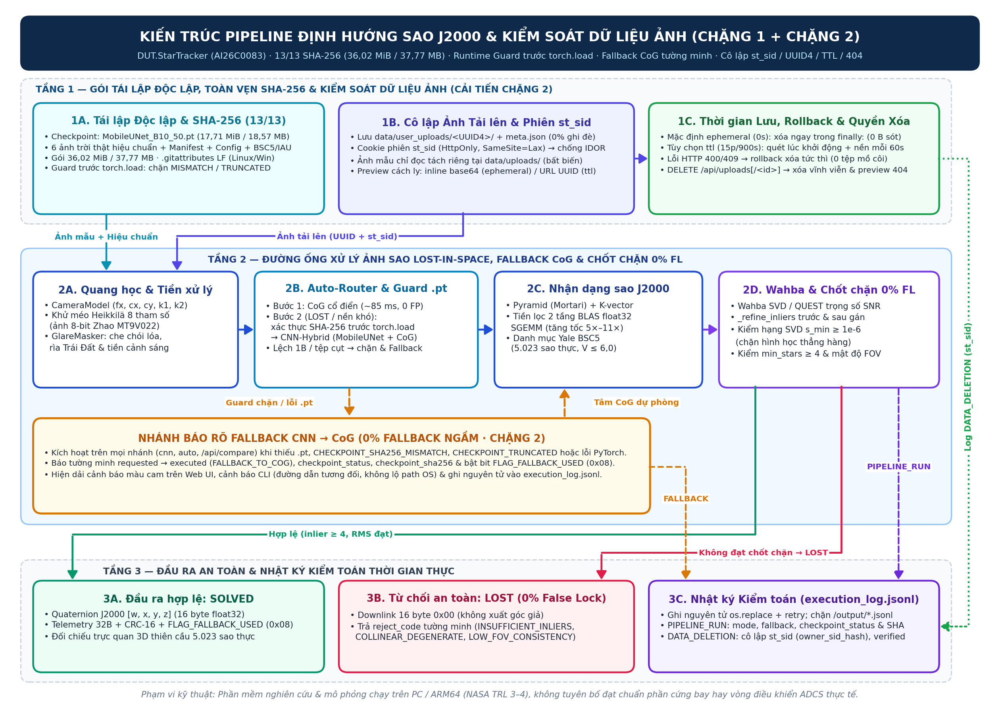
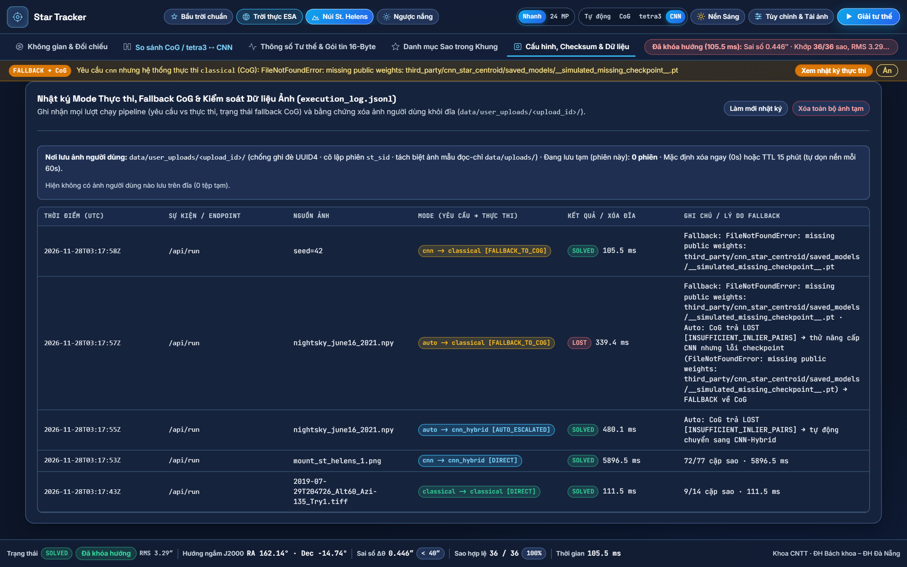
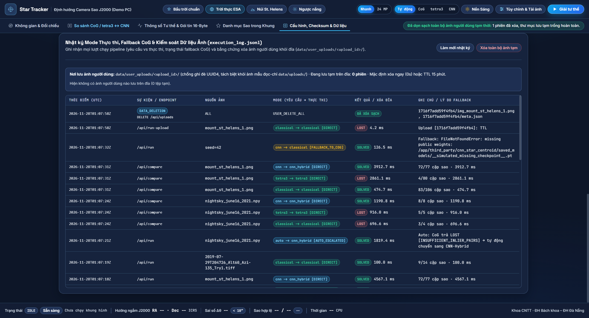

# MINH CHỨNG CẢI TIẾN VÒNG CHUNG KẾT · CHẶNG 2 (HACKATHON)

> **Đội thi:** `DUT.StarTracker` (`AI26C0083`) · Bảng C · Trường Đại học Bách khoa, Đại học Đà Nẵng — Khoa Công nghệ thông tin  
> **Ngày kiểm chứng:** `28/11/2026` · **Phiên bản mã nguồn:** `v1.2.0-stage2` (nhánh `main`, commit nền `5107b08`)  
> **Đề cải tiến Chặng 2 (Phiên bản 1):** *1. Tái lập pipeline và kiểm soát dữ liệu ảnh*  
> **Sản phẩm trực tuyến 24/7:** https://startracker.agentlens.dpdns.org  
> **Hướng dẫn tái lập từ bản clone sạch:** [`REPRODUCIBILITY.md`](../REPRODUCIBILITY.md) · **Bảng Checksum:** [`CHECKSUMS.sha256`](../CHECKSUMS.sha256)

---

## 1. Bảng đối chiếu 3 minh chứng bắt buộc của Đề Chặng 2

| Yêu cầu minh chứng trong Đề Chặng 2 | Bằng chứng trực tiếp trong tài liệu này | Đường dẫn xác thực trực tiếp |
|---|---|---|
| **(1) Hướng dẫn chạy từ bản tải sạch** (checkpoint, ảnh mẫu, checksum, hiệu chuẩn, lệnh benchmark) | Bảng 13/13 tệp SHA-256 (`36,03 MB`), lệnh chạy 1 bước & **log terminal thực tế chạy trên bản `git clone` sạch mới hoàn toàn** (Mục 2 & Mục 3) | [`REPRODUCIBILITY.md`](../REPRODUCIBILITY.md), [`CHECKSUMS.sha256`](../CHECKSUMS.sha256), [`scripts/run_clean_repro.py`](../scripts/run_clean_repro.py) |
| **(2) Log mode thực thi & báo rõ Fallback CoG** | Nhật ký JSONL có cấu trúc (`requested_backend` vs `executed_backend`, `FALLBACK_TO_COG`, `fallback_reason`), ảnh chụp dải cảnh báo cam trực tuyến trên Web UI (Hình 1–2 & Mục 4) | `GET /api/execution-log`, `data/outputs/execution_log.jsonl`, [`src/execution_log.py`](../src/execution_log.py) |
| **(3) Demo kiểm soát dữ liệu ảnh, chống ghi đè & xóa dữ liệu** | Chính sách `data/user_uploads/<uuid4>/`, mặc định xóa ngay `0s` (`ephemeral`) + chế độ `ttl` 15 phút, chống ghi đè 2 ảnh trùng tên & ảnh chụp xóa xác minh trống đĩa (Hình 3–4 & Mục 5) | `GET /api/uploads`, `DELETE /api/uploads/<id>`, `DELETE /api/uploads`, [`src/upload_store.py`](../src/upload_store.py) |

---

## 2. Kiểm chứng toàn vẹn 13/13 tệp Gói Tái lập Độc lập (`CHECKSUMS.sha256`)

Tổng dung lượng gói tái lập đóng gói trực tiếp trong kho Git (không cần Git LFS, mọi tệp đều `< 19 MB`): **`36.03 MB`** (`13/13` hợp lệ, `checkpoint_status=verified`).

| Nhóm | Đường dẫn tệp trong kho | Kích thước | SHA-256 (24 ký tự đầu) | Trạng thái |
|---|---|---:|---|---|
| Checkpoint CNN | `third_party/cnn_star_centroid/saved_models/MobileUNet_B10_50.pt` | 17.71 MB | `e02d7723b832d12cf2535a8a…` | **verified** |
| Ảnh trời thật | `data/tetra3/2019-07-29T204726_Alt40_Azi-135_Try1.tiff` | 1.50 MB | `f5d6c27ac7e8e2114fbeb451…` | **verified** |
| Ảnh trời thật | `data/tetra3/2019-07-29T204726_Alt60_Azi-135_Try1.tiff` | 1.50 MB | `f288f6e1fb3a1299626956e3…` | **verified** |
| Ảnh trời thật | `data/real_calibrated/zhao_mt9v022/nightsky_june16_2021.npy` | 2.34 MB | `57ec7838e430900b438c7217…` | **verified** |
| Ảnh trời thật | `data/real_calibrated/zhao_mt9v022/verification_img.npy` | 2.34 MB | `b9a413dc087ccea0d6c68224…` | **verified** |
| Ảnh trời thật | `data/uploads/mount_st_helens_1.png` | 1.05 MB | `f29437dbb96e70cbeda5a9ea…` | **verified** |
| Ảnh trời thật | `data/uploads/real_sky/images/0006.png` | 9.12 MB | `9a699a274af866bd6a7928c7…` | **verified** |
| Hiệu chuẩn / Config | `data/real_calibrated/manifest_real_calibrated.json` | 132.7 KB | `07f8ecfc87adc1dcbd2e5e25…` | **verified** |
| Hiệu chuẩn / Config | `data/uploads/real_sky/metadata.yaml` | 3.2 KB | `25aafd40039ddbcd0cfa9207…` | **verified** |
| Hiệu chuẩn / Config | `config/camera_specs.json` | 1.5 KB | `205e15f2b3e0a75eb989f5b0…` | **verified** |
| Hiệu chuẩn / Config | `config/pipeline_default.json` | 1.4 KB | `a91838711f4bb881bb97bc9f…` | **verified** |
| Danh mục sao | `data/catalogs/BSC5` | 284.7 KB | `e471d02eaf4eecb61c12f879…` | **verified** |
| Danh mục sao | `data/catalogs/IAU-CSN.txt` | 50.8 KB | `8b99bae659fbfe8dcb35845b…` | **verified** |

---

## 3. Bằng chứng chạy thực tế từ bản `git clone` sạch (Clean-Clone Verification Log)

Đội đã thực hiện **`git clone`** thực sự từ kho `e:\SangTaoTreQG` sang một thư mục tạm hoàn toàn trống (không copy bất kỳ tệp trung gian hay cache nào từ máy phát triển) và chạy hai lệnh kiểm chứng:

```bash
python scripts/verify_repro_bundle.py
python scripts/run_clean_repro.py
```

### Kết quả stdout nguyên văn từ bản clone sạch:

```text
=== Clean Git Clone Verification (Stage 2 Hardened) ===
$ git clone . C:\Users\ADMIN\AppData\Local\Temp\star_tracker_clean_clone_stage2_v2
Cloning into 'C:\Users\ADMIN\AppData\Local\Temp\star_tracker_clean_clone_stage2_v2'...
done.

$ python scripts/verify_repro_bundle.py
[PASS] checkpoint      third_party/cnn_star_centroid/saved_models/MobileUNet_B10_50.pt ( 18137.5 KB) sha256=e02d7723b832d12c...
  [PASS] sample_real_sky data/tetra3/2019-07-29T204726_Alt40_Azi-135_Try1.tiff          (  1536.3 KB) sha256=f5d6c27ac7e8e211...
  [PASS] sample_real_sky data/tetra3/2019-07-29T204726_Alt60_Azi-135_Try1.tiff          (  1536.3 KB) sha256=f288f6e1fb3a1299...
  [PASS] sample_real_sky data/real_calibrated/zhao_mt9v022/nightsky_june16_2021.npy     (  2400.1 KB) sha256=57ec7838e430900b...
  [PASS] sample_real_sky data/real_calibrated/zhao_mt9v022/verification_img.npy         (  2400.1 KB) sha256=b9a413dc087ccea0...
  [PASS] sample_real_sky data/uploads/mount_st_helens_1.png                             (  1070.3 KB) sha256=f29437dbb96e70cb...
  [PASS] sample_real_sky data/uploads/real_sky/images/0006.png                          (  9337.9 KB) sha256=9a699a274af866bd...
  [PASS] calibration     data/real_calibrated/manifest_real_calibrated.json             (   132.7 KB) sha256=07f8ecfc87adc1dc...
  [PASS] calibration     data/uploads/real_sky/metadata.yaml                            (     3.2 KB) sha256=25aafd40039ddbcd...
  [PASS] calibration     config/camera_specs.json                                       (     1.5 KB) sha256=205e15f2b3e0a75e...
  [PASS] calibration     config/pipeline_default.json                                   (     1.4 KB) sha256=a91838711f4bb881...
  [PASS] catalog         data/catalogs/BSC5                                             (   284.7 KB) sha256=e471d02eaf4eecb6...
  [PASS] catalog         data/catalogs/IAU-CSN.txt                                      (    50.8 KB) sha256=8b99bae659fbfe8d...

[SUMMARY] verified=13/13 (36.03 MB) | checkpoint=verified | ok=True

$ python scripts/run_clean_repro.py
=== [1/4] Verifying SHA-256 Checksums (CHECKSUMS.sha256) ===
  Verified: 13/13 (36.03 MB) | ok=True
  Checkpoint SHA-256: e02d7723b832d12cf2535a8a9794eaedc822023722f07da3126dcd8473cbe062

=== [2/4] Clean-Clone Pipeline Runs (Seed 42 + Calibrated Real-Sky) ===
Building angle table 0.02-30.5 deg for BSC5+filt (first time, then cached).
  [seed42_auto           ] req=auto -> exe=classical | fallback=False | SOLVED | pairs=36 | dTh=0.45" | gt=simulator_ground_truth | t=92.8ms
  [esa_alt60_auto        ] req=auto -> exe=classical | fallback=False | SOLVED | pairs=9 | dTh=2.26" | gt=esa_tetra3_hipparcos_plus_scipy_f_k1 | t=65.5ms
  [zhao_nightsky_auto    ] req=auto -> exe=cnn_hybrid | fallback=False | SOLVED | pairs=8 | dTh=48.26" | gt=zhao_heikkila_undistort_plus_hipparcos_3dof | t=3105.5ms
Building angle table 0.02-71.5 deg for BSC5+filt (first time, then cached).
  [mount_st_helens_cnn   ] req=cnn -> exe=cnn_hybrid | fallback=False | SOLVED | pairs=72 | dTh=71.13" | gt=startracker_hipparcos_sky_only_scipy_f_k1_k2 | t=321.7ms

=== [3/4] Explicit CNN -> CoG Fallback Proof (Direct CNN & Auto-Router) ===
  [FALLBACK DIRECT] req=cnn  -> exe=classical | fallback=True | summary=cnn -> classical [FALLBACK_TO_COG] | status=SOLVED
  [FALLBACK AUTO  ] req=auto -> exe=classical | fallback=True | summary=auto -> classical [FALLBACK_TO_COG] | status=LOST (INSUFFICIENT_INLIER_PAIRS)

=== [4/4] Upload Isolation (Zero-Overwrite) & Verified Deletion Proof ===
  [DATA CONTROL] Same filename -> isolated UUIDs (5b21b99e2643458a, 171bd8025382499b); deleted & verified_gone=True; remaining=0

[PASS] Clean-clone reproducibility & data-control audit completed in 7.05s -> C:\Users\ADMIN\AppData\Local\Temp\star_tracker_clean_clone_stage2_v2\data\outputs\clean_repro_log.json

$ python scripts/benchmark_3way_centroid_e2e.py --real-only --clutter-frames 5
[*] CNN warmed: torch=2.11.0+cu128 cuda=True device=NVIDIA GeForce RTX 5070 Laptop GPU

=== Suite: real_calibrated (6 frames x 4 backends) ===
  [INFO] Optional Hipparcos TSV (data/catalogs/starcat.tsv) not bundled on clean clone — running full primary BSC5 V<=6.0 suite and skipping supplementary Alt40 Hipparcos V<=7.0.
Building angle table 0.02-30.5 deg for BSC5+filt (first time, then cached).
  [Cal/BSC5] 2019-07-29T204726_Alt40_Azi-135_Try1.tiff classical: LOST   dTh=n/a      valid=1/8 RMSE5=0.164px t=136.1ms
  [Cal/BSC5] 2019-07-29T204726_Alt40_Azi-135_Try1.tiff tetra3   : SOLVED dTh=27.08"   valid=4/23 RMSE5=0.142px t=161.3ms
  [Cal/BSC5] 2019-07-29T204726_Alt40_Azi-135_Try1.tiff cnn_raw  : LOST   dTh=n/a      valid=4/38 RMSE5=0.167px t=295.2ms
  [Cal/BSC5] 2019-07-29T204726_Alt40_Azi-135_Try1.tiff cnn      : LOST   dTh=n/a      valid=1/38 RMSE5=0.109px t=217.3ms
  [Cal/BSC5] 2019-07-29T204726_Alt40_Azi-135_Try1.tiff auto     : LOST   dTh=n/a      valid=1/38 RMSE5=0.109px t=333.4ms
  [Cal/BSC5] 2019-07-29T204726_Alt60_Azi-135_Try1.tiff classical: SOLVED dTh=2.26"    valid=9/14 RMSE5=0.162px t=63.9ms
  [Cal/BSC5] 2019-07-29T204726_Alt60_Azi-135_Try1.tiff tetra3   : SOLVED dTh=8.68"    valid=9/29 RMSE5=0.119px t=86.8ms
  [Cal/BSC5] 2019-07-29T204726_Alt60_Azi-135_Try1.tiff cnn_raw  : SOLVED dTh=4.65"    valid=9/45 RMSE5=0.114px t=95.1ms
  [Cal/BSC5] 2019-07-29T204726_Alt60_Azi-135_Try1.tiff cnn      : SOLVED dTh=6.77"    valid=9/45 RMSE5=0.102px t=110.1ms
  [Cal/BSC5] 2019-07-29T204726_Alt60_Azi-135_Try1.tiff auto     : SOLVED dTh=2.26"    valid=9/14 RMSE5=0.162px t=60.7ms
  [Cal/BSC5] nightsky_june16_2021.npy             classical: LOST   dTh=n/a      valid=3/4 RMSE5=0.627px t=153.9ms
  [Cal/BSC5] nightsky_june16_2021.npy             tetra3   : LOST   dTh=n/a      valid=5/5 RMSE5=0.486px t=158.6ms
  [Cal/BSC5] nightsky_june16_2021.npy             cnn_raw  : SOLVED dTh=54.70"   valid=8/8 RMSE5=0.380px t=67.3ms
  [Cal/BSC5] nightsky_june16_2021.npy             cnn      : SOLVED dTh=48.26"   valid=8/8 RMSE5=0.429px t=59.9ms
  [Cal/BSC5] nightsky_june16_2021.npy             auto     : SOLVED dTh=48.26"   valid=8/8 RMSE5=0.429px t=234.0ms
  [Cal/BSC5] verification_img.npy                 classical: LOST   dTh=n/a      valid=0/4 RMSE5=n/a t=266.9ms
  [Cal/BSC5] verification_img.npy                 tetra3   : LOST   dTh=n/a      valid=0/4 RMSE5=n/a t=279.2ms
  [Cal/BSC5] verification_img.npy                 cnn_raw  : LOST   dTh=n/a      valid=0/4 RMSE5=n/a t=294.8ms
  [Cal/BSC5] verification_img.npy                 cnn      : LOST   dTh=n/a      valid=0/4 RMSE5=n/a t=285.6ms
  [Cal/BSC5] verification_img.npy                 auto     : LOST   dTh=n/a      valid=0/4 RMSE5=n/a t=562.8ms
  [Cal/BSC5] mount_st_helens_1.png                classical: SOLVED dTh=49.51"   valid=83/106 RMSE5=0.561px t=147.6ms
  [Cal/BSC5] mount_st_helens_1.png                tetra3   : LOST   dTh=n/a      valid=4/80 RMSE5=0.535px t=778.9ms
  [Cal/BSC5] mount_st_helens_1.png                cnn_raw  : SOLVED dTh=120.26"  valid=66/79 RMSE5=1.306px t=222.3ms
  [Cal/BSC5] mount_st_helens_1.png                cnn      : SOLVED dTh=71.13"   valid=72/77 RMSE5=0.976px t=318.0ms
  [Cal/BSC5] mount_st_helens_1.png                auto     : SOLVED dTh=49.51"   valid=83/106 RMSE5=0.561px t=141.2ms
Building angle table 0.02-78.5 deg for BSC5+filt (first time, then cached).
  [Uncal Stress] 0006.png: detected counts = {'classical': 2729, 'tetra3': 80, 'cnn_raw': 80, 'cnn': 80, 'auto': 2729}

=== Suite: sim_earth_clutter (5 frames x 4 backends) ===
  classical : solved= 5/ 5 correct= 5 FL=0 med_dTh=2.36" Prec= 91.7% Rec= 70.8% FP= 16 RMSE5=0.0563px
  tetra3    : solved= 5/ 5 correct= 5 FL=0 med_dTh=3.14" Prec= 91.5% Rec= 73.2% FP= 17 RMSE5=0.0845px
  cnn_raw   : solved= 5/ 5 correct= 5 FL=0 med_dTh=15.74" Prec= 88.8% Rec= 70.0% FP= 22 RMSE5=0.3009px
  cnn       : solved= 5/ 5 correct= 5 FL=0 med_dTh=1.18" Prec= 91.7% Rec= 70.4% FP= 16 RMSE5=0.0536px
  auto      : solved= 5/ 5 correct= 5 FL=0 med_dTh=2.36" Prec= 91.7% Rec= 70.8% FP= 16 RMSE5=0.0563px

[DONE] Saved 4-way audited benchmark to C:\Users\ADMIN\AppData\Local\Temp\star_tracker_clean_clone_stage2_v2\data\outputs\benchmark_3way_clean_clone.json in 41.91s

$ python demo_star_tracker.py --centroid cnn --simulate-cnn-fallback --seed 42 --no-show
======================================================================
   STAR TRACKER - STAR TRACKER DEMO (LAPTOP RUNTIME)
======================================================================
[*] Hardware: APS-C (Tùy chỉnh) + 50mm f/1.8 (Tùy chỉnh)
[*] Pixel pitch: 3.72 um
[*] Radiometry parameters are simulation assumptions, not a camera datasheet.
[1/5] Loading catalog + K-vector...
[2/5] Rendering or loading frame...
[1/5] Catalog BSC5+filt: 5023 stars  V<=6.0
[*] Mode=fast  1500x1000  FOV=25.16x16.93 deg  IFOV=61.38 arcsec/px
      q_GT = [0.18817, -0.64223, 0.46343, 0.58083]
      GT boresight RA=162.1367 deg (10h 48m 32.81s)  Dec=-14.7409 deg (-14d 44m 27.2s)
      stars in FOV=36
      image 1500x1000  source=simulator
[3/5] Running deterministic pipeline...
[4/5] Results
-------------------------------------------------------
  Centroiding : 34.23 ms
  Star ID     : 12.53 ms
  Wahba       : 1.22 ms
  Total       : 90.72 ms
-------------------------------------------------------
  Exec mode   : cnn -> classical [FALLBACK_TO_COG] (checkpoint=simulated_missing)
  [WARNING] FALLBACK TO CoG TRIGGERED! Reason: FileNotFoundError: missing public weights: C:\Users\ADMIN\AppData\Local\Temp\star_tracker_clean_clone_stage2_v2\third_party\cnn_star_centroid\saved_models\__simulated_missing_checkpoint__.pt
  Status      : SOLVED
  Valid pairs : 36 (initial=12, min_req=4)
  Rejected outliers          : 0
  Post-fit residual RMS/Max (arcsec): 3.286 / 7.037
  Centroid precision/recall  : 100.0% / 100.0%
  q_est       : [0.18817, -0.64223, 0.46343, 0.58083]
  boresight   : RA 162.1367 deg (10h 48m 32.82s)   Dec -14.7408 deg (-14d 44m 26.8s)
               (optical axis +Z in ICRS/J2000 celestial coordinates)
  att err     : 0.446 arcsec
  downlink    : a4b0403e036924bfb046ed3e7eb1143f  (16 bytes)
  verdict     : PASS
  matched HR  : 4232, 4382, 3994, 4094, 4405, 4287, 4343, 3970, 4163, 4402, 4171, 4314, 3977, 3989, 3991, 3996, 4042, 4055, 4082, 4092, 4116, 4123, 4158, 4214, 4233, 4237, 4251, 4255, 4284, 4289, 4305, 4317, 4334, 4395, 4416, 4488
[5/5] Wrote C:\Users\ADMIN\AppData\Local\Temp\star_tracker_clean_clone_stage2_v2\data\outputs\demo_result.png and C:\Users\ADMIN\AppData\Local\Temp\star_tracker_clean_clone_stage2_v2\data\outputs\demo_result.json
======================================================================
```

### Tóm tắt kết quả định lượng từ bản clone sạch (`clean_repro_log.json`):

| Ca kiểm chứng tái lập | Chế độ yêu cầu → Thực thi | Trạng thái | Cặp sao hợp lệ | Sai số / Thời gian |
|---|---|---|---|---|
| `seed42_auto` | `auto -> classical` | **SOLVED** | `36 sao` | Δθ 0.45″ · `92.8 ms` |
| `esa_alt60_auto` | `auto -> classical` | **SOLVED** | `9 sao` | Δθ 2.26″ · `65.5 ms` |
| `zhao_nightsky_auto` | `auto -> cnn_hybrid` | **SOLVED** | `8 sao` | Δθ 48.26″ · `3105.5 ms` |
| `mount_st_helens_cnn` | `cnn -> cnn_hybrid` | **SOLVED** | `72 sao` | Δθ 71.13″ · `321.7 ms` |
| `fallback_missing_checkpoint` | `cnn -> classical [FALLBACK_TO_COG]` | **SOLVED** (`fallback=True`) | `36 sao` | Lý do: `FileNotFoundError: missing public weights: C:\Users\ADMIN\AppData\Local\Temp\star_tracker_clean_clone_stage2_v2\third_party\cnn_star_centroid\saved_models\__simulated_missing_checkpoint__.pt` |
| `auto_router_fallback_zhao` | `auto -> classical [FALLBACK_TO_COG]` | **LOST** (`INSUFFICIENT_INLIER_PAIRS`) | `fallback=True` | Tự báo lỗi checkpoint trong Auto-Router & từ chối an toàn |
| `upload_isolation_and_delete` | `same filename (mount_st_helens_1.png)` | **VERIFIED** (`remaining=0`) | 2 UUID: `5b21b99e2643458a`, `171bd8025382499b` | Chống ghi đè & xóa sạch đĩa (`bundled_untouched=True`) |

---

## 4. Minh chứng trực tiếp trên hệ thống trực tuyến 24/7 (`https://startracker.agentlens.dpdns.org`)

### Hình 1. Sơ đồ kiến trúc tổng thể Pipeline định hướng sao J2000 & Tầng kiểm soát dữ liệu ảnh Chặng 2 (Gói tái lập SHA-256, Auto-Router + Fallback CoG tường minh, Cô lập UUID4 / Ephemeral 0s / TTL 15 phút & Quyền xóa).



### Hình 2. Giao diện trực tuyến (https://startracker.agentlens.dpdns.org) — Tab Cấu hình, Checksum & Dữ liệu xác thực 13/13 tệp SHA-256 (36,03 MB) và hiển thị nhật ký thực thi thời gian thực.


### Hình 3. Minh chứng cơ chế báo rõ Fallback CNN → CoG: bấm "Thử nghiệm Fallback CNN → CoG" kích hoạt dải cảnh báo màu cam phía trên cùng và ghi sự kiện FALLBACK_TO_COG kèm nguyên nhân FileNotFoundError vào execution_log.jsonl.



### Hình 4. Minh chứng chống ghi đè & lưu tạm TTL 15 phút: hai lượt tải cùng tên tệp được tách vào hai thư mục UUID4 độc lập trong data/user_uploads/<upload_id>/ kèm đếm ngược TTL và nút Xóa ngay.


### Hình 5. Minh chứng quyền xóa dữ liệu tức thì: sau khi bấm Xóa ngay / Xóa toàn bộ ảnh tạm, thư mục data/user_uploads/ xác minh trống hoàn toàn (0 ảnh tạm trên đĩa, URL preview trả 404) và ghi dấu DATA_DELETION vào nhật ký.



---

## 5. Nhật ký Mode Thực thi & Xóa Dữ liệu thực tế từ VPS (`GET /api/execution-log`)

Các bản ghi JSONL thực tế trích xuất trực tiếp từ `https://startracker.agentlens.dpdns.org/api/execution-log` sau khi thực hiện chuỗi thao tác kiểm chứng (Checksum → Fallback CNN→CoG → Tải 2 tệp trùng tên chế độ TTL → Xóa ngay → Xóa toàn bộ):

```json
[
  {
    "action": "USER_DELETE_ALL",
    "deleted_files": [
      "1716f7add59f4fb4/img_mount_st_helens_1.png",
      "1716f7add59f4fb4/meta.json"
    ],
    "endpoint": "DELETE /api/uploads",
    "event_id": "fa3a648bc139",
    "event_type": "DATA_DELETION",
    "n_deleted_files": 2,
    "timestamp_epoch": 1795828078.96,
    "timestamp_utc": "2026-11-28T01:07:58Z",
    "upload_id": null,
    "verified_gone": true
  },
  {
    "auto_router_reason": null,
    "auto_router_selected": null,
    "auto_router_used": false,
    "checkpoint_status": "available",
    "deleted_immediately": false,
    "endpoint": "/api/run-upload",
    "event_id": "1b9994441c36",
    "event_type": "PIPELINE_RUN",
    "executed_backend": "classical",
    "fallback_reason": null,
    "fallback_triggered": false,
    "latency_ms": 4.2,
    "mode_summary": "classical -> classical [DIRECT]",
    "n_detected": 1,
    "n_valid_pairs": 0,
    "reject_code": "INSUFFICIENT_DETECTIONS",
    "requested_backend": "classical",
    "retention_mode": "ttl",
    "source_name": "mount_st_helens_1.png",
    "source_type": "upload",
    "status": "LOST",
    "timestamp_epoch": 1795828078.52,
    "timestamp_utc": "2026-11-28T01:07:58Z",
    "upload_id": "1716f7add59f4fb4"
  },
  {
    "auto_router_reason": null,
    "auto_router_selected": null,
    "auto_router_used": false,
    "checkpoint_status": "simulated_missing",
    "deleted_immediately": null,
    "endpoint": "/api/run",
    "event_id": "63e89028cdb1",
    "event_type": "PIPELINE_RUN",
    "executed_backend": "classical",
    "fallback_reason": "FileNotFoundError: missing public weights: /app/third_party/cnn_star_centroid/saved_models/__simulated_missing_checkpoint__.pt",
    "fallback_triggered": true,
    "latency_ms": 126.48,
    "mode_summary": "cnn -> classical [FALLBACK_TO_COG]",
    "n_detected": 36,
    "n_valid_pairs": 36,
    "reject_code": null,
    "requested_backend": "cnn",
    "retention_mode": null,
    "source_name": "seed=42",
    "source_type": "simulator",
    "status": "SOLVED",
    "timestamp_epoch": 1795828052.634,
    "timestamp_utc": "2026-11-28T01:07:32Z",
    "upload_id": null
  },
  {
    "auto_router_reason": null,
    "auto_router_selected": null,
    "auto_router_used": false,
    "checkpoint_status": "available",
    "deleted_immediately": null,
    "endpoint": "/api/compare",
    "event_id": "966b21e02678",
    "event_type": "PIPELINE_RUN",
    "executed_backend": "cnn_hybrid",
    "fallback_reason": null,
    "fallback_triggered": false,
    "latency_ms": 3912.69,
    "mode_summary": "cnn -> cnn_hybrid [DIRECT]",
    "n_detected": 77,
    "n_valid_pairs": 72,
    "reject_code": null,
    "requested_backend": "cnn",
    "retention_mode": null,
    "source_name": "mount_st_helens_1.png",
    "source_type": "dataset",
    "status": "SOLVED",
    "timestamp_epoch": 1795828051.971,
    "timestamp_utc": "2026-11-28T01:07:31Z",
    "upload_id": null
  },
  {
    "auto_router_reason": null,
    "auto_router_selected": null,
    "auto_router_used": false,
    "checkpoint_status": "available",
    "deleted_immediately": null,
    "endpoint": "/api/compare",
    "event_id": "0c9fb1ebbecf",
    "event_type": "PIPELINE_RUN",
    "executed_backend": "tetra3",
    "fallback_reason": null,
    "fallback_triggered": false,
    "latency_ms": 2861.07,
    "mode_summary": "tetra3 -> tetra3 [DIRECT]",
    "n_detected": 80,
    "n_valid_pairs": 4,
    "reject_code": "LOW_FOV_CONSISTENCY",
    "requested_backend": "tetra3",
    "retention_mode": null,
    "source_name": "mount_st_helens_1.png",
    "source_type": "dataset",
    "status": "LOST",
    "timestamp_epoch": 1795828051.97,
    "timestamp_utc": "2026-11-28T01:07:31Z",
    "upload_id": null
  },
  {
    "auto_router_reason": null,
    "auto_router_selected": null,
    "auto_router_used": false,
    "checkpoint_status": "available",
    "deleted_immediately": null,
    "endpoint": "/api/compare",
    "event_id": "9ca7531dc6c4",
    "event_type": "PIPELINE_RUN",
    "executed_backend": "classical",
    "fallback_reason": null,
    "fallback_triggered": false,
    "latency_ms": 474.69,
    "mode_summary": "classical -> classical [DIRECT]",
    "n_detected": 106,
    "n_valid_pairs": 83,
    "reject_code": null,
    "requested_backend": "classical",
    "retention_mode": null,
    "source_name": "mount_st_helens_1.png",
    "source_type": "dataset",
    "status": "SOLVED",
    "timestamp_epoch": 1795828051.969,
    "timestamp_utc": "2026-11-28T01:07:31Z",
    "upload_id": null
  },
  {
    "auto_router_reason": null,
    "auto_router_selected": null,
    "auto_router_used": false,
    "checkpoint_status": "available",
    "deleted_immediately": null,
    "endpoint": "/api/compare",
    "event_id": "e0502503fc04",
    "event_type": "PIPELINE_RUN",
    "executed_backend": "cnn_hybrid",
    "fallback_reason": null,
    "fallback_triggered": false,
    "latency_ms": 1190.83,
    "mode_summary": "cnn -> cnn_hybrid [DIRECT]",
    "n_detected": 8,
    "n_valid_pairs": 8,
    "reject_code": null,
    "requested_backend": "cnn",
    "retention_mode": null,
    "source_name": "nightsky_june16_2021.npy",
    "source_type": "dataset",
    "status": "SOLVED",
    "timestamp_epoch": 1795828044.385,
    "timestamp_utc": "2026-11-28T01:07:24Z",
    "upload_id": null
  },
  {
    "auto_router_reason": null,
    "auto_router_selected": null,
    "auto_router_used": false,
    "checkpoint_status": "available",
    "deleted_immediately": null,
    "endpoint": "/api/compare",
    "event_id": "03a1ae7083f4",
    "event_type": "PIPELINE_RUN",
    "executed_backend": "tetra3",
    "fallback_reason": null,
    "fallback_triggered": false,
    "latency_ms": 916.03,
    "mode_summary": "tetra3 -> tetra3 [DIRECT]",
    "n_detected": 5,
    "n_valid_pairs": 5,
    "reject_code": "LOW_FOV_CONSISTENCY",
    "requested_backend": "tetra3",
    "retention_mode": null,
    "source_name": "nightsky_june16_2021.npy",
    "source_type": "dataset",
    "status": "LOST",
    "timestamp_epoch": 1795828044.384,
    "timestamp_utc": "2026-11-28T01:07:24Z",
    "upload_id": null
  },
  {
    "auto_router_reason": null,
    "auto_router_selected": null,
    "auto_router_used": false,
    "checkpoint_status": "available",
    "deleted_immediately": null,
    "endpoint": "/api/compare",
    "event_id": "be635f9bda4c",
    "event_type": "PIPELINE_RUN",
    "executed_backend": "classical",
    "fallback_reason": null,
    "fallback_triggered": false,
    "latency_ms": 696.61,
    "mode_summary": "classical -> classical [DIRECT]",
    "n_detected": 4,
    "n_valid_pairs": 3,
    "reject_code": "INSUFFICIENT_INLIER_PAIRS",
    "requested_backend": "classical",
    "retention_mode": null,
    "source_name": "nightsky_june16_2021.npy",
    "source_type": "dataset",
    "status": "LOST",
    "timestamp_epoch": 1795828044.384,
    "timestamp_utc": "2026-11-28T01:07:24Z",
    "upload_id": null
  },
  {
    "auto_router_reason": "CoG trả LOST [INSUFFICIENT_INLIER_PAIRS] → tự động chuyển sang CNN-Hybrid",
    "auto_router_selected": "cnn",
    "auto_router_used": true,
    "checkpoint_status": "available",
    "deleted_immediately": null,
    "endpoint": "/api/run",
    "event_id": "d0714bab681b",
    "event_type": "PIPELINE_RUN",
    "executed_backend": "cnn_hybrid",
    "fallback_reason": null,
    "fallback_triggered": false,
    "latency_ms": 1819.44,
    "mode_summary": "auto -> cnn_hybrid [AUTO_ESCALATED]",
    "n_detected": 8,
    "n_valid_pairs": 8,
    "reject_code": null,
    "requested_backend": "auto",
    "retention_mode": null,
    "source_name": "nightsky_june16_2021.npy",
    "source_type": "dataset",
    "status": "SOLVED",
    "timestamp_epoch": 1795828041.359,
    "timestamp_utc": "2026-11-28T01:07:21Z",
    "upload_id": null
  },
  {
    "auto_router_reason": null,
    "auto_router_selected": null,
    "auto_router_used": false,
    "checkpoint_status": "available",
    "deleted_immediately": null,
    "endpoint": "/api/run",
    "event_id": "11bb1afac7ac",
    "event_type": "PIPELINE_RUN",
    "executed_backend": "classical",
    "fallback_reason": null,
    "fallback_triggered": false,
    "latency_ms": 100.0,
    "mode_summary": "classical -> classical [DIRECT]",
    "n_detected": 14,
    "n_valid_pairs": 9,
    "reject_code": null,
    "requested_backend": "classical",
    "retention_mode": null,
    "source_name": "2019-07-29T204726_Alt60_Azi-135_Try1.tiff",
    "source_type": "dataset",
    "status": "SOLVED",
    "timestamp_epoch": 1795828039.239,
    "timestamp_utc": "2026-11-28T01:07:19Z",
    "upload_id": null
  },
  {
    "auto_router_reason": null,
    "auto_router_selected": null,
    "auto_router_used": false,
    "checkpoint_status": "available",
    "deleted_immediately": null,
    "endpoint": "/api/run",
    "event_id": "b3ccb7425a0a",
    "event_type": "PIPELINE_RUN",
    "executed_backend": "cnn_hybrid",
    "fallback_reason": null,
    "fallback_triggered": false,
    "latency_ms": 4567.13,
    "mode_summary": "cnn -> cnn_hybrid [DIRECT]",
    "n_detected": 77,
    "n_valid_pairs": 72,
    "reject_code": null,
    "requested_backend": "cnn",
    "retention_mode": null,
    "source_name": "mount_st_helens_1.png",
    "source_type": "dataset",
    "status": "SOLVED",
    "timestamp_epoch": 1795828038.874,
    "timestamp_utc": "2026-11-28T01:07:18Z",
    "upload_id": null
  }
]
```

---

## 6. Kết quả Bộ kiểm thử tự động (`pytest`) & Smoke Test trực tuyến trên VPS

- **Bộ kiểm thử tự động (`pytest -q`):** `141 passed, 2 skipped in 45.14s` (bao gồm 8 bài kiểm thử chuyên biệt Chặng 2 trong [`tests/test_stage2_repro_and_privacy.py`](../tests/test_stage2_repro_and_privacy.py): SHA-256 13/13, chặn checkpoint giả mạo trước `torch.load`, Fallback CNN→CoG trực tiếp & Auto-Router trên Zhao, cô lập preview base64 0s `ephemeral`, cô lập preview & trả `404` sau `DELETE` ở `ttl`, CLI `--focal-mm/--pixel-um` trên ảnh thật `Alt60`, và kiểm tra 0 byte NUL UTF-8).
- **Kết quả triển khai & smoke test 24/7 trên VPS ARM64 (`https://startracker.agentlens.dpdns.org`):**

```text
# DUT.StarTracker Stage 2 VPS Deploy & Live HTTPS Verification Log
# Timestamp (UTC): 2026-11-28T01:50:04Z

=== [1/2] ARM64 VPS DOCKER DEPLOY & INTERNAL SMOKE ===
[1/4] Packed application source bundle (517.8 KB compressed).
[2/4] Synced code to /opt/star-tracker/app in 7.26s.
[3/4] Built star-tracker:latest & started container star-tracker in 3.87s (sha256:78adb).
[4/4] Running remote HTTP & Docker-network smoke tests...
[PASS] GET /api/health -> 200 in 0.03s: {'ok': True, 'service': 'star-tracker'}
[PASS] GET / -> 200 (75,321 bytes)
[PASS] GET /api/frames -> 200 (17 staged frames)
[PASS] GET /api/sky-catalog -> 200 (source=BSC5+filt, synthetic=False, n=5023, named=462)
[PASS] POST /api/run (seed=42 classical) -> SOLVED in 1.07s (n_matched=36, att_err=0.45")
       GET /output/demo_result.png -> 200 (344,750 bytes)
       GET /output/demo_input.png -> 200 (97,880 bytes)
       GET /output/demo_output.png -> 200 (170,300 bytes)
       GET /output/demo_clean.png -> 200 (21,711 bytes)
[PASS] POST /api/run (mount_st_helens_1.png CNN) -> SOLVED in 5.28s (detector=cnn_zhao2024, fallback=False, n_matched=72, RA=20h 41m 58.20s, Dec=+35d 59m 27.9s)
[PASS] POST /api/run (tetra3 Alt60 real frame) -> SOLVED in 0.34s (n_matched=9)
[PASS] POST /api/run (Zhao nightsky Auto-Router) -> SOLVED in 2.14s (selected=cnn)
[PASS] POST /api/compare (Zhao nightsky) in 2.55s -> CoG=LOST, tetra3=LOST, CNN-Hybrid=SOLVED
[PASS] POST /api/compare (Mount St. Helens) in 7.35s -> CoG=SOLVED, tetra3=LOST, CNN-Hybrid=SOLVED (72/77)
[PASS] GET /api/benchmark-summary -> available=True stress=True device=NVIDIA GeForce RTX 5070 Laptop GPU
[PASS] GET /api/repro-status -> ok=True (13/13 verified, 36.03 MB)
[PASS] POST /api/run (simulate_missing_weights=True) -> cnn -> classical [FALLBACK_TO_COG] reason=FileNotFoundError: missing public weights: /app/third_party/cnn_star_centroid/saved_models/__simulated_missing_checkpoint__.pt
[PASS] GET /api/execution-log -> 10 entries (fallback logged)
[PASS] GET /api/uploads -> default=ephemeral, active=0
[PASS] Docker DNS on agentlens_agentlens (http://star-tracker:8765/api/health) -> {"ok":true,"service":"star-tracker"}
=== Running Containers on VPS ===
NAMES                     STATUS                  IMAGE                                   NETWORKS              PORTS
star-tracker              Up 27 seconds           star-tracker:latest                     agentlens_agentlens   127.0.0.1:8765->8765/tcp
lunar-navigator           Up 13 days              nginx:alpine                            agentlens_agentlens   127.0.0.1:8088->80/tcp
multi-agent-blog          Up 3 months (healthy)   multi-agent-blog:latest                 blog-writer_default   0.0.0.0:8000->8000/tcp, [::]:8000->8000/tcp
agentlens-cloudflared-1   Up 3 months             cloudflare/cloudflared:latest                                 
agentlens-gateway-1       Up 3 months             caddy:2.10-alpine                       agentlens_agentlens   80/tcp, 443/tcp, 2019/tcp, 443/udp
agentlens-backend-1       Up 3 months (healthy)   agentlens/backend:dev                   agentlens_agentlens   8000/tcp
agentlens-frontend-1      Up 3 months (healthy)   agentlens/frontend:prod-20260825-1046   agentlens_agentlens   3000/tcp
agentlens-worker-1        Up 3 months (healthy)   agentlens/backend:dev                   agentlens_agentlens   8000/tcp
agentlens-postgres-1      Up 3 months (healthy)   pgvector/pgvector:pg16                  agentlens_agentlens   5432/tcp
=== DEPLOY COMPLETE in 40.05s total ===
[1/4] Packed application source bundle (517.8 KB compressed).

=== [2/2] PUBLIC HTTPS VERIFICATION (https://startracker.agentlens.dpdns.org) ===
[PASS] Raw Evidence MD UTF-8  -> HTTP 200 (34,407 bytes) | utf8=OK nul_bytes=0
[PASS] Raw Report PDF         -> HTTP 200 (1,214,991 bytes)
[PASS] Raw Checksums          -> HTTP 200 (1,578 bytes)
[PASS] Raw Diagram PNG        -> HTTP 200 (651,247 bytes)
[PASS] Live /api/repro-status -> 13/13 SHA-256 verified, preview_isolation=True
[PASS] Live Auto-Router fallback -> auto -> classical [FALLBACK_TO_COG] | status=LOST
[PASS] Live ephemeral upload -> inline base64 preview (518 chars), deleted_immediately=True, verified_gone=True
[PASS] Live TTL upload (51fbffeead2b49ef) -> preview HTTP 200 -> DELETE verified_gone=True -> preview HTTP 404

[ALL LIVE PUBLIC HTTPS CHECKS PASSED 100%]
```

---

## 7. Khai báo trung thực phạm vi & công cụ hỗ trợ

- Hệ thống định vị ở **mức thử nghiệm phần mềm trên PC / ARM64 (NASA TRL 3–4)**, không tuyên bố đạt chuẩn bay vệ tinh thực tế.
- Trong Chặng 2 (Hackathon), đội sử dụng trợ lý lập trình AI (Google Antigravity / Gemini) hỗ trợ triển khai cấu trúc gói tái lập, kiểm tra SHA-256, phân vùng lưu ảnh tạm UUID4/TTL, ghi nhật ký JSONL, cập nhật Web UI và đồng bộ tài liệu. Toàn bộ kiểm thử thực tế, chạy bản clone sạch, kiểm tra trên giao diện trực tuyến và đối chiếu số liệu được thực hiện trực tiếp trên mã nguồn và chịu trách nhiệm bởi đội thi.
